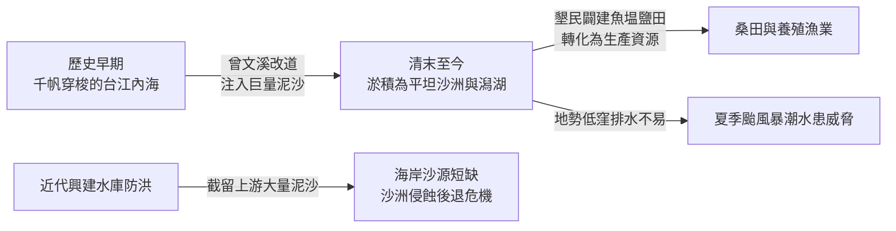
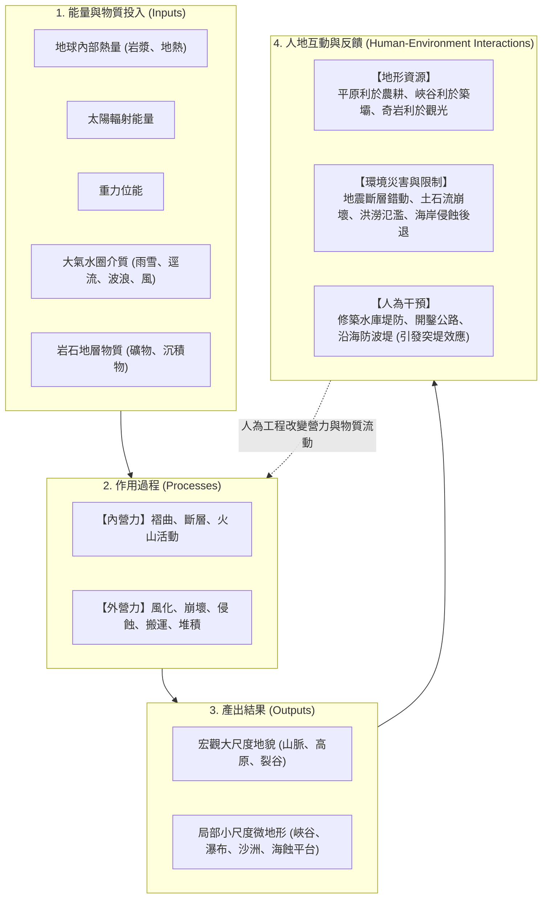

# 00. 章首導讀：地形系統概念與人地互動

:::info
**【核心思辨】地形系統的變遷，對人類而言究竟是帶來資源，還是帶來災害？**
地表是人類文明發展的舞臺。本章將帶領同學從「系統（System）」的宏觀視角，透視地表起伏變化的營力機制，並反思人類與動態地形環境之間的永續共存之道。
:::

---

## 一、情境導讀：從台江滄海到七股桑田

站在**臺南市七股區**曾文溪出海口北岸的**頂頭額沙洲**上，矗立著臺灣本島極西點——**國聖燈塔**。望向內側，是波光粼粼的**七股潟湖**，蚵架井然有序；望向外側，則是臺灣海峽洶湧的波浪。

這片土地的歷史，正是地形系統動態演育與人地互動的典型縮影：
1. **滄海變桑田（資源獲取）**：昔日為千帆穿梭的台江內海，後因曾文溪多次改道帶來龐大泥沙，泥沙在波浪與沿岸流搬運堆積下，使內海迅速淤積成陸地與沙洲，先民得以開墾農田、闢建魚塭與鹽田。
2. **水患威脅（環境限制）**：新生地地勢低窪，排水不良，每逢夏季暴雨與颱風暴潮，洪澇災害便成為沿海居民的沉重威脅。
3. **人為干預的連鎖反應（系統反饋）**：晚近政府為治理水患與供應用水，於河流上游興建多座水庫，雖顯著減緩了下游水患，卻也截留了大量隨水流下的泥沙，造成河口沙源供應銳減。缺乏泥沙補充的濱外沙洲在海浪持續拍擊下逐漸被淘空後退，威脅七股潟湖的養殖漁業及極西點沙洲的保存。

---

## 二、地表舞台：大尺度與小尺度的景觀交織

地表擁有千變萬化的起伏形態：
- **大尺度地形（Macro-scale）**：涵蓋橫亙數千公里的山脈、廣闊的高原、封閉的盆地、低緩的丘陵與平坦的平原。例如聳入雲霄的臺灣中央山脈、世界屋脊喜馬拉雅山脈。
- **小尺度微地形（Micro-scale）**：聚焦於局部特定營力塑造的細緻景觀，如迎風堆積的沙丘、受波浪與風化雕琢的蕈狀岩、高山寒凍崩落的碎石坡、地下溶洞內滴凝而成的鐘乳石。

不同的空間尺度，背後運作的營力類型、影響的時間範疇各不相同，但彼此緊密交扣，共同構成了人類生活的立體舞臺。

---

## 三、何謂「地形系統（Geomorphic System）」？

所謂**系統（System）**，是指由一組相互依存、共同運作的組成單元（Components），藉由**能量（Energy）**與**物質（Matter）**的流動與轉換而相互關聯的整體。

:::warning
**人地雙向省思：開發與風險的平衡**
- 在山區開闢景觀公路固然促進交通與觀光，但削切邊坡破壞平衡，是否埋下了土石崩塌與山崩的隱患？
- 濱海奇岩怪石創造了龐大的遊憩商機，但駐足遊客是否意識到瘋狗浪與岩石落石的潛在致命危機？
- 河川築堤束水保護了堤內社區，卻是否使得河床泥沙淤高、出海口沙源中斷？
:::

---

## 四、本章學習導航與核心素養

本章內容劃分為三大核心主軸與一項專題地理實作：

| 學習節次 | 核心探討主題 | 聚焦重要概念與在地/全球實例 |
| :--- | :--- | :--- |
| **第一節 地形系統與營力** | 地形運作概念、內營力與外營力機制 | 褶曲（背斜向斜）、斷層（地壘地塹）、火山（基隆山/澎湖柱狀玄武岩/維蘇威）、物理/化學風化、四大崩壞類型、差異侵蝕、**探究 4-1 野柳女王頭** |
| **第二節 流水、岩溶與冰河塑造的地形** | 外營力三大主力雕琢之陸地景觀 | 河流三向侵蝕、侵蝕基準面、沖積扇湧泉帶（五溝水）、氾濫平原、曲流與牛軛湖、河階（大溪）、喀斯特地下洞穴（泰國睡美人洞）、冰蝕與冰積地形、**探究 4-2 屏東平原水利改道** |
| **第三節 風、波浪塑造的地形與辨識** | 乾燥與濱海交會處之地貌動態 | 風蝕（礫漠岩漠）、風積沙丘（草漯沙丘）與黃土高原、海蝕地貌、海積沙洲潟湖、離水海階（石梯坪） vs 沉水谷灣、突堤效應、**探究 4-3 桃園海岸侵蝕後退** |
| **活動篇 地理實作 GO** | 1904 臺灣堡圖與地名中的地形密碼 | 空間資訊判讀、澳底（灣澳）、四鯤鯓（沙洲）、三層（河階）、灣仔（曲流）、沙崙（沙丘）之生活地名與環境智識 |

---
*下一節：[01. 地形系統的概念與空間尺度](01-geomorphic-systems.md)*
