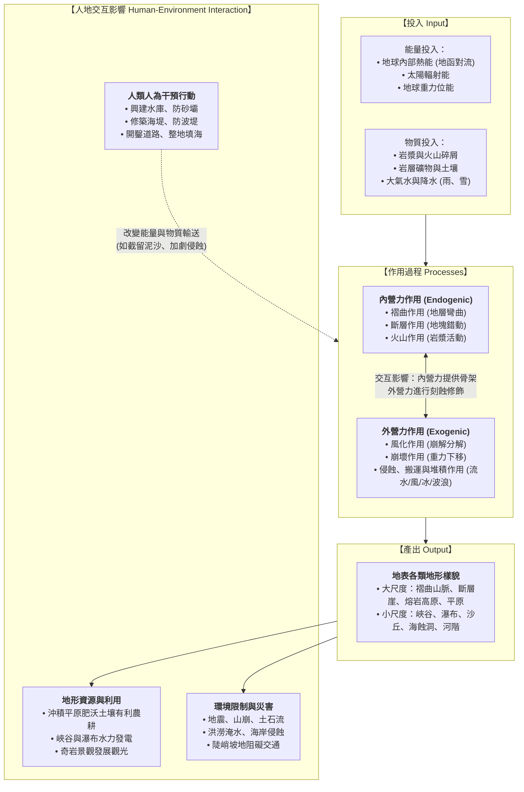

# 01. 地形系統的概念與空間尺度

:::info
**【學習重點】**
1. 理解「系統」的科學意涵，掌握地形系統中「能量投入 $\rightarrow$ 營力作用 $\rightarrow$ 地形產出 $\rightarrow$ 人類活動」的運作機制。
2. 釐清內營力與外營力的根本能量來源、作用速度與空間規模差異。
3. 掌握地形學中的「空間尺度（Spatial Scale）」思維，學會從微觀沙丘視角跨越到宏觀全球氣候與板塊分布。
:::

---

## 一、什麼是地形系統？

地表不是靜止不變的死寂外殼，而是一個隨時處於物質轉換與能量流動中的**動態開放系統**。

### 1. 系統的核心定義
**系統（System）**是指由一組具有特定關聯性的物體、要素或現象所構成的有機整體。組成系統的各單元之間，藉由**能量的流動**與**物質的轉移**緊密相繫。

### 2. 地形系統運作架構（對應課本圖 4-1）

---

## 二、內營力與外營力的比較

形塑地表形態的兩大核心推手為**內營力**與**外營力**，兩者的對比如下表所示：

| 比較項目 | 內營力 (Endogenic Forces) | 外營力 (Exogenic Forces) |
| :--- | :--- | :--- |
| **主要能量來源** | **地球內部熱量**（放射性元素衰變、地函對流、地心殘存高熱） | **太陽輻射能量**（驅動水循環與大氣環流）與**地球重力** |
| **主要運作介質** | 岩漿、地函熱柱、地殼板塊岩石層 | 地表流水、地下水、冰河、海水波浪/沿岸流、風、生物 |
| **核心作用形式** | 褶曲作用、斷層作用、火山作用、板塊造山運動 | 風化、崩壞、侵蝕、搬運、堆積作用 |
| **空間影響範圍** | **廣大（大尺度為主）**，常涵蓋數千公里山脈或地塊 | **局部至中微尺度**，但長期普遍作用於整個地表 |
| **塑造地形之角色** | **形塑地表的基本骨架與構造**（奠定粗胚大輪廓） | **雕琢細部形態的雕塑師**（削平高山、填平低窪） |
| **作用時間與速度** | 造山運動常需數百萬年；火山噴發與地震斷層則為瞬間突發 | 既有暴雨洪澇、土石流的瞬間破壞，亦有千年滴水穿石的緩慢演育 |

:::info
**重要觀念提醒：**
地表任何一處地形，都不是單一營力獨立塑造的產物，而是**內營力奠定骨架後，外營力接續或同時進行雕琢改造的連續性動態平衡**。
:::

---

## 三、地形系統的空間尺度（Spatial Scale）

在地形學的探討中，「尺度」是解開地景之謎的關鍵金鑰。課本以「沙丘與沙漠」為例（圖 4-2），展示了不同尺度下地理學家提出的提問視角：

### 1. 小尺度微地形的觀察提問
當我們身處局部沙丘時，關注重點在於**直接營力的物理機制與當前形態**：
- 這座沙丘高度有多高？迎風坡與背風坡的坡度有何差異？
- 風向與風速如何搬運沙粒？沙丘會隨時間移動嗎？
- 為什麼沙丘表面缺乏植被生長？（保水不易、基質流動性高）
- 這些細沙的源頭從何而來？（鄰近河流沉積物或底岩風化）

### 2. 大尺度宏觀系統的探究提問
當我們將視野拉升至衛星與全球地圖時，提問轉向**宏觀氣候動力與地體構造格局**：
- 為什麼撒哈拉沙漠橫跨北非？為什麼納米比沙漠集中在非洲西南部？（受副熱帶高壓帶下沉氣流、沿岸本吉拉涼流降溫減濕影響）
- 沙丘僅能在熱帶沙漠中發現嗎？（否，臺灣西海岸如草漯沙丘、高緯度冰河外洗區亦可見沙丘）
- 全球各大洲的沙漠分布是否具備對稱性與規律性？

:::spoiler 點擊展開：尺度思維在學習上的應用
地理學的思維核心在於「**拉遠能看全局格局，拉近能析物理機轉**」。面對同一種地形，切勿只背誦名稱，應學會切換尺度思考其地質年代背景、宏觀氣候控制，以及局部的營力力學行為！
:::

---
*上一節：[00. 章首導讀](00-introduction.md) ｜ 下一節：[02. 內營力與地形演育](02-endogenic-processes.md)*
