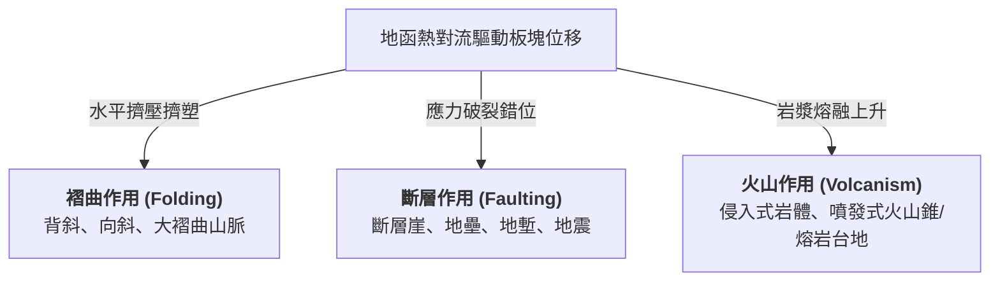
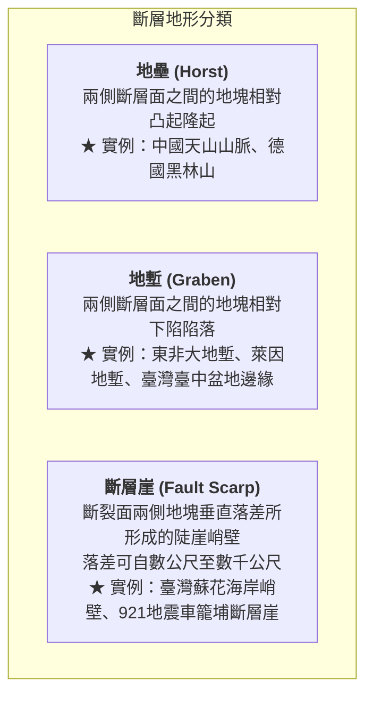
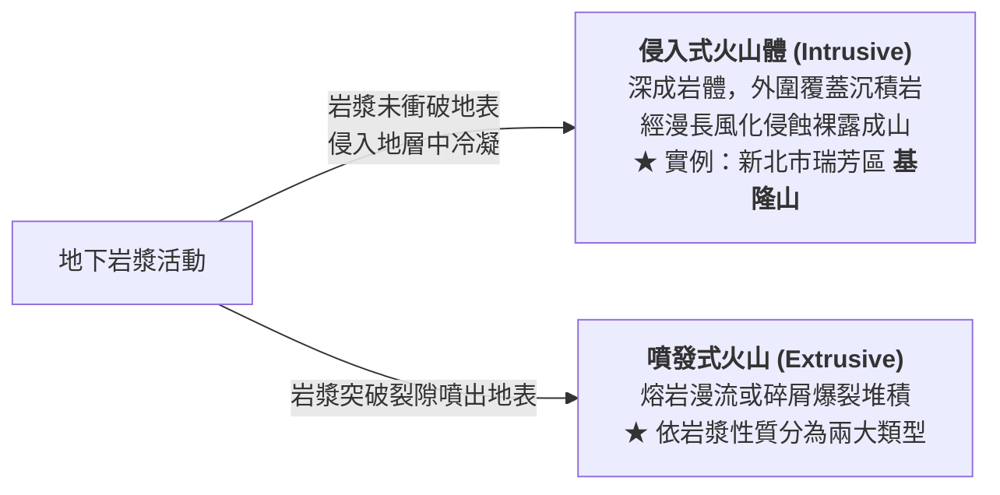
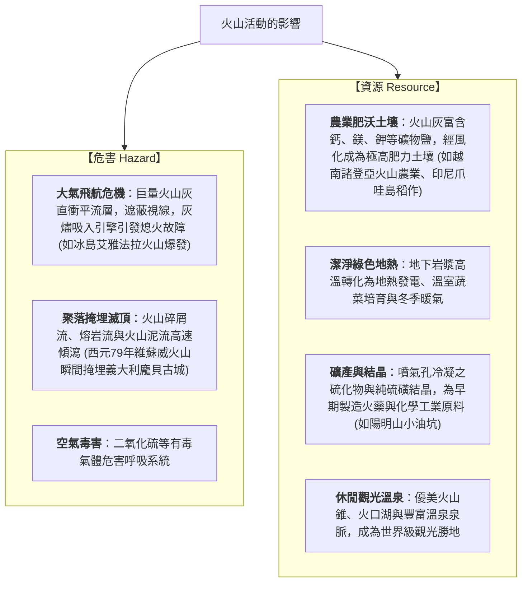

# 02. 內營力與地形演育（褶曲、斷層、火山）

:::info
**【學習重點】**
1. 掌握地函對流驅動板塊運動，如何透過「褶曲」、「斷層」、「火山」奠定全球大尺度地貌架構。
2. 辨識背斜與向斜、地壘與地塹、斷層崖之構造特徵與實例。
3. 對比「寧靜式噴發」與「猛烈式噴發」的岩漿性質（二氧化矽含量、黏度）、火山體形態與景觀。
4. 深度剖析火山活動對人類社會帶來的「災害危機」與「資源利基」。
:::

---

## 一、內營力之源：板塊構造與能量驅動

內營力的根本動力源自**地球內部的熱能**。地函深處的放射性同位素衰變釋放高熱，引發地函物質產生緩慢的**熱對流（Mantle Convection）**，進而帶動上方剛硬的岩石圈板塊相互分離、擠壓或錯動。

板塊邊界的強烈變形，在地表留下三種關鍵的構造地形：


---

## 二、褶曲作用（Folding）

### 1. 作用機制與構造名詞
當原本水平堆積的沉積岩層受到板塊**水平擠壓力**作用，在未達破裂強度前產生塑性變形，呈現波浪起伏的彎曲形態，稱為**褶曲（Fold）**。

```mermaid
graph LR
    subgraph Fold["褶曲構造受力示意"]
        P1["擠壓力 ➔"] --> Ant["<b>背斜 (Anticline)</b><br>地層向上隆起凸起<br>核部岩層年代較老"]
        Ant --> Syn["<b>向斜 (Syncline)</b><br>地層向下凹陷彎曲<br>核部岩層年代較新"]
        Syn <-- P2["⬅ 擠壓力"]
    end
```

### 2. 褶曲山脈與造山運動
在板塊隱沒或碰撞擠壓的大陸邊界，強大的造山運動往往抬升出綿延數千公里的**褶曲山脈**。這些山脈高聳崎嶇，常成為大河奔流的發源地，例如：
- **臺灣中央山脈**（菲律賓海板塊擠壓歐亞板塊）
- **喜馬拉雅山脈**（印澳板塊撞擊歐亞板塊，世界最高峰聖母峰所在）
- **阿爾卑斯山脈**、**安地斯山脈**、**落磯山脈**

:::info
**【知識解鎖】新褶曲山脈 vs 古老結晶陸塊**

| 比較維度 | 新褶曲山脈 (Young Fold Mountains) | 古老結晶陸塊 (Old Crystalline Shields) |
| :--- | :--- | :--- |
| **形成地質年代** | 近代（約 **3,500 萬年以來**的新生代） | 極古老（距今 **2 億 8,000 萬年以前**的古生代甚至前寒武紀） |
| **岩石組成性質** | 沉積岩、輕度變質岩為主，岩層破碎褶皺 | 長期高溫高壓固結的堅硬火成岩（花崗岩）、深變質岩（片麻岩） |
| **受外營力時間** | 受到外營力風化侵蝕的時間**相對短暫** | 遭受外營力漫長數億年的刻蝕撫平，削磨殆盡 |
| **地表起伏特徵** | **山勢高聳險峻、地勢起伏劇烈、坡陡谷深** | **地表起伏微緩、呈低矮平原或微起伏高原（準平原化）** |
| **世界代表實例** | 喜馬拉雅山脈、阿爾卑斯山脈、臺灣中央山脈 | 芬蘭地盾、加拿大地盾、西澳大利亞高原 |
:::

---

## 三、斷層作用（Faulting）

### 1. 作用機制
當地殼岩層所承受的擠壓、張裂或剪切應力，**超過岩石自身的承受極限（破裂強度）**時，岩層便會瞬間破裂，沿破裂面兩側地塊發生相對滑動或錯位，稱為**斷層（Fault）**。
- **地震的誕生**：斷層破裂與地塊錯動瞬間所釋放的巨大應變能，以彈性波的形式穿透地層，引發地表劇烈晃動，即為**地震（Earthquake）**。

### 2. 三大核心斷層地形



### 3. 臺灣的活動斷層與地體構造
- 臺灣本島地處歐亞板塊與菲律賓海板塊碰撞擠壓的樞紐位置，地殼活動極度活躍，全島已知分布有 **36 條活動斷層**（如課本圖 4-6）。
- **921 大地震（1999年）實例**：車籠埔斷層發生劇烈逆衝錯動，在原臺中縣霧峰鄉光復國中操場造成高達數公尺的地面抬升破裂，形成怵目驚心的斷層崖，印證斷層瞬間重塑地表的巨大力量。

---

## 四、火山作用（Volcanism）

火山作用多分布於**板塊隱沒帶（如環太平洋火環帶）**、**板塊張裂帶（如中洋脊、東非大裂谷）**及**地函熱點（如夏威夷群島）**。

### 1. 侵入式火山 vs 噴發式火山



### 2. 噴發式火山兩大類型深度對比

| 噴發類型 | 寧靜式噴發 (Effusive Eruption) | 猛烈式噴發 (Explosive Eruption) |
| :--- | :--- | :--- |
| **主要岩漿性質** | **基性岩漿（玄武岩質）** | **中性至酸性岩漿（安山岩質、流紋岩質）** |
| **二氧化矽 ($SiO_2$) 含量** | **較低**（約 45% ~ 52%） | **較高**（> 55% ~ 70%） |
| **岩漿黏度與流動性** | **黏度極小、流動性極大** | **黏度極大、流動性極小（濃稠）** |
| **內部氣體散逸難易** | 氣體極易順暢逸散，**不易積聚高壓** | 濃稠岩漿封閉氣體，**極易蓄積極大高壓** |
| **噴發特徵** | 溫和溢流、少爆裂、熔岩長距離漫流 | 劇烈爆裂噴發、噴發口四周岩石爆碎拋擲 |
| **冷卻後地貌形態** | **熔岩台地、熔岩高原**、盾狀火山 | **錐狀火山（火山錐）**、複式火山、火口湖 |
| **典型代表實例** | 澎湖群島（桶盤嶼玄武岩柱狀節理）、美國哥倫比亞高原、夏威夷群島 | 印尼克里穆圖火山（火口湖）、厄瓜多通古拉瓦火山、日本富士山、臺灣大屯火山群 |

---

## 五、火山活動的危害與資源

火山活動對人類文明展現了極端強烈的「雙面性格」：



:::spoiler 點擊展開自我檢核測驗
**Q：為什麼澎湖群島呈平坦的方山台地，而七星山卻是高聳的錐狀火山？**
- **解析**：澎湖由基性玄武岩岩漿冷卻而成，二氧化矽含量低、流動性大，噴發時順著裂隙向四周漫流鋪展，冷卻後形成開闊平坦的熔岩台地；大屯火山群的七星山則由中酸性安山岩岩漿構成，流動性差、黏度高，火山碎屑物與熔岩在噴發口附近層層堆疊，形成聳拔的火山錐。
:::

---
*上一節：[01. 地形系統的概念與空間尺度](01-geomorphic-systems.md) ｜ 下一節：[03. 外營力與地形演育](03-exogenic-processes.md)*
