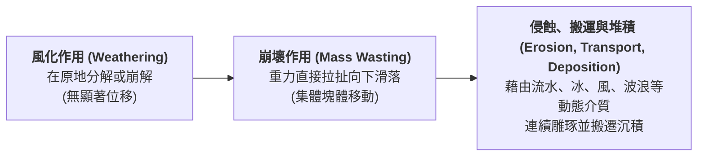
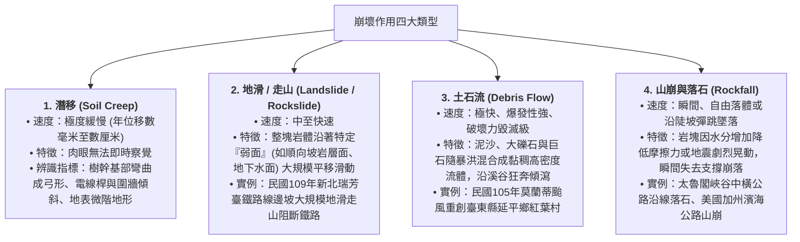
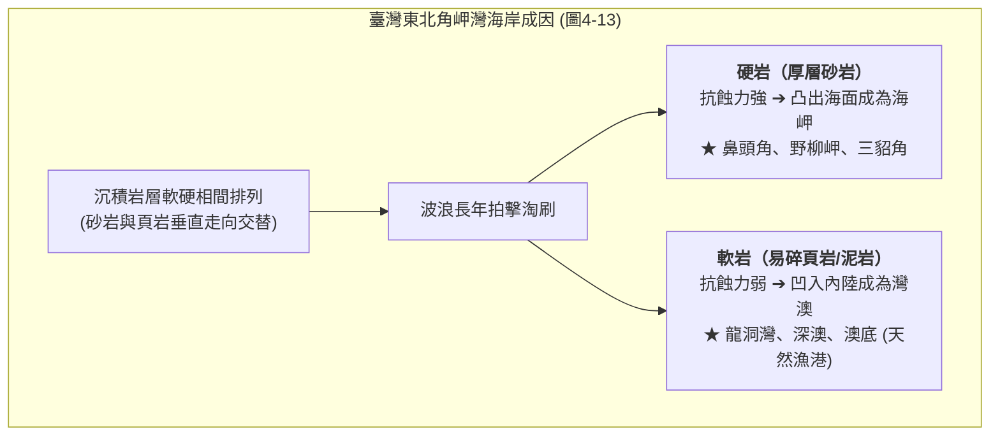
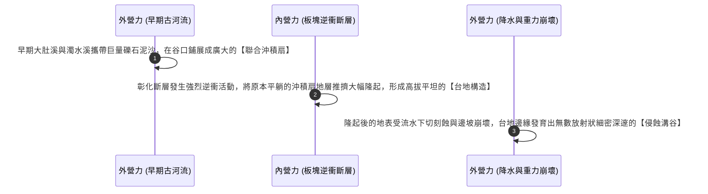

# 03. 外營力與地形演育（風化、崩壞、侵蝕堆積）

:::info
**【學習重點】**
1. 掌握外營力兩大根本驅動力——**太陽輻射能**與**地球重力**的運作機制。
2. 釐清物理風化（熱脹冷縮、凍融作用）與化學風化（氧化反應、酸雨溶蝕）之環境發育條件。
3. 掌握四大崩壞類型（潛移、地滑、土石流、落石）之運動速率、含水量及判讀指標。
4. 理解差異侵蝕原理及其在臺灣海岸地貌的展現；透析八卦台地內外營力接力演育的完整歷程。
:::

---

## 一、外營力之源與基本機制

外營力主要藉由太陽輻射能驅動大氣與水循環，並在大氣圈、水圈與生物圈的共同參與下，配合地球重力牽引，不斷對地表展開**削高填低**的雕塑工程。

---

## 二、風化作用（Weathering）

風化作用是指地表岩石在**原地**受到大氣、水或生物影響，產生**崩解破裂**或**化學分解**的作用，**不涉及長距離搬運**。

### 1. 物理風化（崩解） vs 化學風化（分解）

| 風化類型 | 物理風化 (Mechanical / Physical Weathering) | 化學風化 (Chemical Weathering) |
| :--- | :--- | :--- |
| **本質變化** | 僅改變岩石外觀大小，**化學礦物成分不變** | 岩石礦物與水、氧、酸反應，**化學成分根本改變** |
| **主要好發環境** | **氣候乾燥、日夜溫差大**的沙漠，或**高山、高緯度寒冷區** | **高溫多雨、濕熱**的熱帶與副熱帶氣候區 |
| **核心作用機制** | 1. **熱脹冷縮**：岩石外層與內層導熱不均，受日夜溫差反覆膨脹收縮，導致表層如洋蔥般剝落（南非北開普省）。 2. **凍融作用（冰劈作用）**：水滲入岩石裂隙，結冰時體積膨脹約 9%，產生強大撐張力裂解巨石（加拿大格羅摩恩山碎石坡、南極洲彼德曼島）。 | 1. **氧化作用**：岩石中的鐵與水、氧結合形成氧化鐵（鐵鏽），在岩面形成如抽象畫般的「風化紋」（美國帕利亞峽谷）。 2. **水解與碳酸化**：水及二氧化碳形成的碳酸溶解岩石。 3. **酸雨腐蝕**：工業酸雨（硫酸、硝酸）腐蝕戶外大理石雕像（德國賀騰古堡雕像面目模糊）。 |

:::tip
**自然界實況：**
在真實地表環境中，物理風化與化學風化絕非孤立發生。物理風化將岩石破裂成碎屑，**大幅增加了岩石的暴露表面積**，進而倍數加速化學風化的反應速率！
:::

---

## 三、崩壞作用（Mass Wasting）

地表的土壤與岩石碎屑，主要在**地球重力**的直接牽引下，沿坡面由高處向低處移動的現象，稱為**崩壞作用**。

### 1. 崩壞發生的四大誘發條件
1. **坡度陡峭**：重力沿坡向下的下滑分力大於抗滑力。
2. **水分劇增**：豪雨使土石含水量飽和，大幅增加總重量，且水具有孔隙水壓力，大幅降低岩層間的摩擦力。
3. **地質破碎脆弱**：順向坡構造、節理發達、頁岩與砂岩互層且膠結不良。
4. **人為不當開挖**：削切坡腳、超限利用、破壞天然植被水土保持。

### 2. 四大崩壞類型矩陣剖析（對應課本圖 4-12）

---

## 四、侵蝕、搬運與堆積作用

遭受風化與崩壞鬆動的岩屑，隨後被流水、海浪、風或冰河等外營力介質持續沖刷（侵蝕）、位移（搬運），並在動能衰減處卸載沉澱（堆積），形成動態演變的連續體。

### 1. 差異侵蝕（Differential Erosion）
地表岩層的抗蝕能力並非完全均質。火成岩、變質岩或質地堅硬的砂岩抗蝕力強；而泥岩、頁岩或斷裂破碎帶抗蝕力弱。在相同外營力作用下，兩者因消耗速度不同而形成凹凸對比鮮明的地貌。

---

## 五、內外營力交互作用實例：八卦台地的誕生演育

課本圖 4-14 彰化縣與南投縣交界的**八卦台地**，是內營力與外營力在時間長河中交接棒演育的經典範例：

:::info
**【精髓結論】**
- **內營力是地景的建築師**：造山、抬升、斷層形成骨架。
- **外營力是地景的雕刻刀**：風化、侵蝕、切割出豐富萬千的細微輪廓。
兩者此消彼長，造就了我們今日所見的大地容顏。
:::

---
*上一節：[02. 內營力與地形演育](02-endogenic-processes.md) ｜ 下一節：[04. 探究 4-1：野柳女王頭的歲月痕跡](04-case-study-yehliu.md)*
