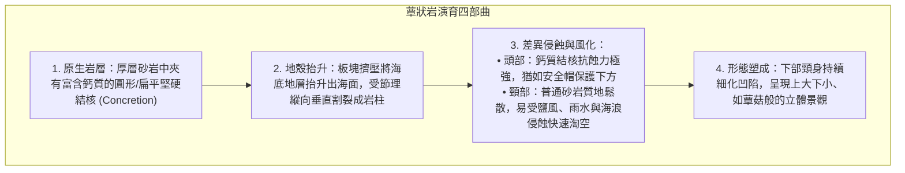
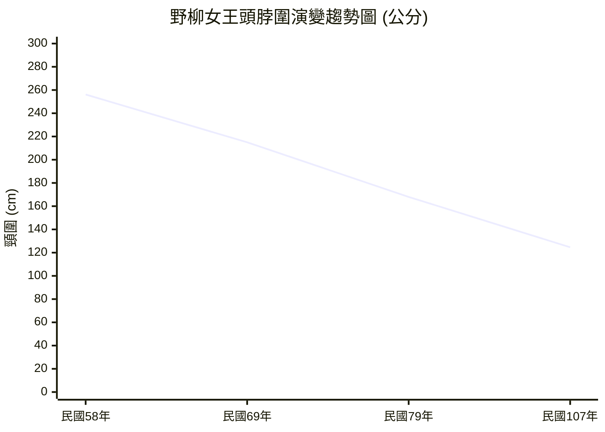

# 04. 探究 4-1：野柳女王頭的歲月痕跡與蕈狀岩

:::info
**【探究情境】**
位於新北市萬里區的野柳地質公園，長年以鬼斧神工的海岸奇岩聞名遐邇，其中「女王頭」更是享譽國際的臺灣觀光地標。然而，學者與管理處長期觀測發現，女王頭的脖圍正隨著歲月持續縮水，未來正面臨無可避免的「斷頸危機」！
:::

---

## 一、蕈狀岩（Mushroom Rock）的形成機制

女王頭在地質學上屬於典型的**蕈狀岩（Mushroom Rock / Hoodoo）**。其形成過程是**地質構造、岩石抗蝕性差異與外營力作用**交織而成的傑作：

---

## 二、女王頭脖圍歷史監測數據

野柳地質公園自民國 58 年起，對女王頭的頸部進行了長期科學監測：

| 觀測年代 | 民國 58 年 (1969) | 民國 69 年 (1980) | 民國 79 年 (1990) | 民國 107 年 (2018) |
| :---: | :---: | :---: | :---: | :---: |
| **脖圍量測數值** | **256.14 cm** | 逐漸消瘦 | 持續淘細 | **僅剩 124.6 cm** |
| **外觀演變特徵** | 頸部豐滿厚實，輪廓渾厚 | 頸部線條漸顯苗條 | 凹陷日趨明顯 | 頸線極細，頭重腳輕，風化持續 |

---

## 三、課本探究提問與深度解析（對應課本 P16）

### 問題 1：女王頭屬於何種尺度的地形？
:::success
**【參考解答】**
屬於**小尺度（微尺度，Micro-scale）微地形**。  
女王頭是單一奇石景觀，其長寬僅數公尺至十數公尺，是局部外營力（海風、鹽風化、風化淋溶）在特定微小空間內精細雕琢的微型地貌。
:::

### 問題 2：由照片 4-6 得知，女王頭外形變化最大的部位為何處？
:::success
**【參考解答】**
**頸部（脖圍部位）**。  
頸圍由民國 58 年的 256.14 公分，銳減至民國 107 年的 124.6 公分，萎縮超過一半，頸部受淘空程度最為劇烈，承重脆弱度日益升高。
:::

### 問題 3：女王頭屬於蕈狀岩地形。分析通常造成蕈狀岩地形的主要原因為何？
:::success
**【參考解答】**
核心成因為**差異風化（Differential Weathering）與差異侵蝕（Differential Erosion）**：
1. **頂部（頭部）**：為富含碳酸鈣質的堅硬結核，膠結緻密，抵抗風雨侵蝕與鹽風化能力強。
2. **下部（頸部）**：為一般沉積砂岩，缺乏高鈣膠結物，質地較軟且節理裂隙發達，在大氣乾濕交替、日照熱脹冷縮及海水飛沫鹽分結晶撐裂作用下，剝落速度遠快於頂部，導致頸部不斷被掏空細化。
:::

### 問題 4：估計在未來 10～15 年間女王頭頸部恐將斷裂。我們應該利用現代奈米科技塗料人為加固延長壽命，還是順應自然任其斷裂？
:::warning
**【核心思辨：地質保育 vs 自然演育】**
本題為開放式人地價值思辨題，兩種立場皆有其深刻論述：

- **支持人為科技補強（文化景觀與經濟觀點）**：
  - 女王頭已是臺灣國際意象代表與幾代人的集體歷史文化記憶，具備無可替代的品牌價值。
  - 野柳每年吸引數百萬國際與在地觀光客，維持女王頭可保障在地觀光產業發展與經濟生計。
  - 科技保護（如奈米防水透氣固化劑）是現代文化與地質遺產維護的合理手段。

- **支持順應自然法則（地質演育與生態倫理觀點）**：
  - 地貌本是動態系統，誕生、成熟、凋零與瓦解是自然營力演育的必然規律。強行人工固化，反而失去地質活教材的科學真諦。
  - 野柳隨時都在孕育新的奇石，例如民國 99 年因崩落新形成、被遊客票選命名為「**俏皮公主**」的蕈狀岩，正是女王頭最佳的天然接班人。
  - 自然的消失能成為最震撼人心的環境教育題材，教育人類學會尊重自然演化、珍惜當下地景。
:::

---
*上一節：[03. 外營力與地形演育](03-exogenic-processes.md) ｜ 下一節：[05. 河流作用與地形](05-fluvial-landforms.md)*
