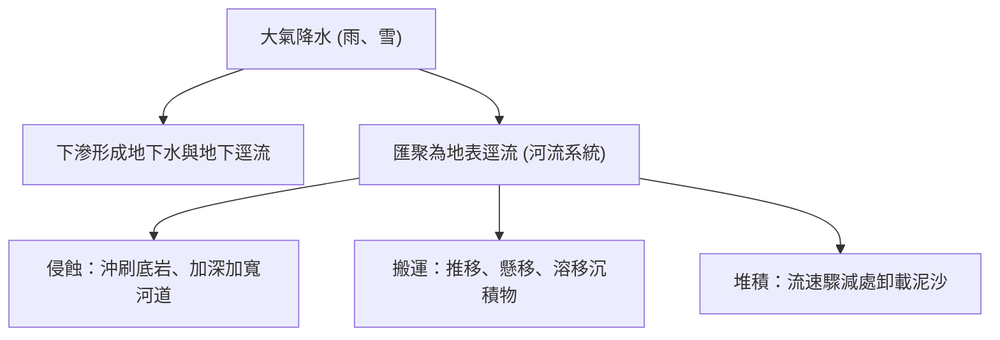
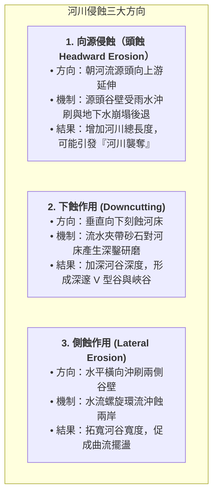
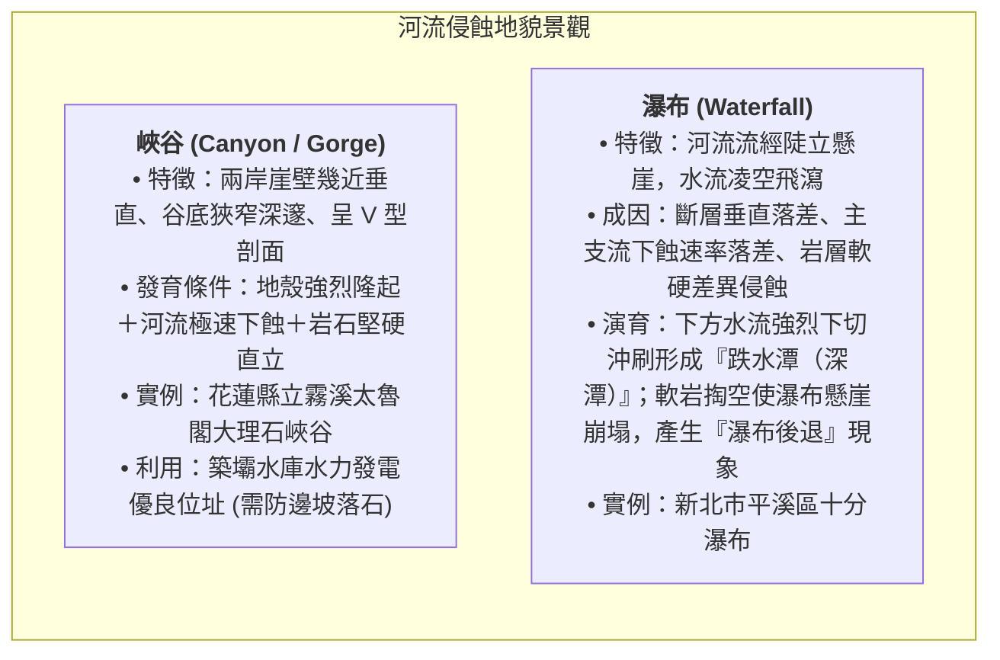
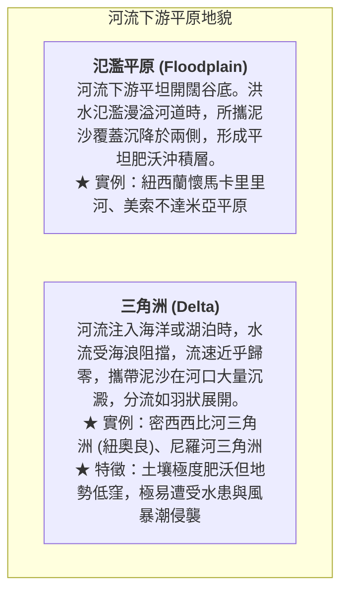

# 05. 河流作用與地形（上中下游、侵蝕搬運堆積、河階曲流）

:::info
**【學習重點】**
1. 掌握陸地流水系統與河川侵蝕的三大方向（向源侵蝕、下蝕、側蝕）及侵蝕基準面概念。
2. 剖析河流上游侵蝕地形（峽谷、瀑布）的成因機制與等高線特徵。
3. 精熟山麓沖積扇（扇頂、扇央、扇端湧泉帶）沉積物粒徑、地下水文與土地利用對比。
4. 深度解析曲流凹岸（基蝕坡）與凸岸（滑走坡）的水力學差異、牛軛湖演育及河階地質成因。
:::

---

## 一、河流作用與水文動力

流水是地表分布最廣、雕塑威力最強大的外營力介質。降水降落地表後，扣除蒸發與下滲，匯聚成地表逕流奔騰入海。

### 1. 決定河流流速與侵蝕力的關鍵要素
- **地勢落差（坡度）**：坡度愈陡，水流重力分力愈大，流速愈迅猛。
- **河流流量**：流量愈充沛，動能愈大。
- **河道斷面特徵**：河道狹窄深邃時，水流集中，流速顯著提升。

### 2. 河川侵蝕的三大方向（對應課本圖 4-16）

### 3. 侵蝕基準面（Base Level）
河流向下侵蝕具有不可跨越的最低物理極限，稱為**侵蝕基準面**：
- **終極侵蝕基準面**：即**海平面**。陸地河流最終無法下切至海平面以下。
- **暫時侵蝕基準面**：河流中途注入的湖泊、水庫水面，或支流匯入主流的交匯口。
- **基準面變動引發回春作用**：若地殼抬升或海平面相對下降，相當於侵蝕基準面相對降低，河流下蝕潛能瞬間復甦，重新劇烈下切，孕育河階與峽谷。

---

## 二、河流侵蝕地形

主要發育於**河流上游**高山地區，此區落差大、流速急，以**下蝕與向源侵蝕**為主導。

---

## 三、河流堆積地形

主要發育於**河流出山口、中下游平原與河口**，此區坡度變緩、流幅變寬，水流動能減弱，泥沙紛紛沉澱。

### 1. 山麓沖積扇（Alluvial Fan）深入剖析
河流自崇山峻嶺奔出谷口進入開闊平原時，流速驟減，大量砂礫在谷口向外展開沉積成半圓形扇狀地貌（圖 4-19）。

| 沖積扇分區 | 沉積物顆粒 | 透水性與地表水 | 農業與土地利用形態 | 災害風險 |
| :--- | :--- | :--- | :--- | :--- |
| **扇頂 (Apex)** (近谷口) | 巨石、粗礫石為主 | 透水性極佳，地表水迅速下滲，地下水位極深 | 水源匱乏，早期開發晚；以果園、旱作或林地為主 | 出山口首當其衝，暴洪與**土石流**高危險區 |
| **扇央 (Fan Body)** (扇面中部) | 砂礫與中粒粗砂 | 透水性良好，乾旱期地表常形成季節性乾溪 | 旱田、茶園、果樹；聚落零星分布 | 洪水漫流改道侵蝕 |
| **扇端 (Toe)** (扇面外緣) | 細砂、黏土與粉砂 | **地下水遇阻截，在此呈帶狀自地表湧出，形成「湧泉帶」** | **水源極度充沛、灌溉便利，土地開墾早，水稻田廣布，聚落密集**（如屏東縣萬巒鄉**五溝水**） | 地勢低平易有內澇積水 |

### 2. 氾濫平原與三角洲

---

## 四、侵蝕與堆積共同作用地形：曲流與河階

河流在中下游或平緩盆地，侵蝕與堆積往往在同一河段左右兩岸同步上演。

### 1. 曲流（Meander）與牛軛湖（Oxbow Lake）演育
當平原河流因流路受阻或河幅擺盪，會發展出迂迴蜿蜒的曲流（圖 4-22）：

#### 凹岸 vs 凸岸 水力學特性對比

| 比較項目 | 凹岸（基蝕坡 Cut Bank） | 凸岸（滑走坡 Point Bar） |
| :--- | :--- | :--- |
| **水流衝擊情況** | 主流線直衝外側，水流湍急 | 位於流線內側，水流減緩滯留 |
| **主要營力作用** | **侵蝕作用（強烈側蝕淘刷）** | **堆積作用（泥沙平鋪淤積）** |
| **橫斷面地形** | **谷壁陡峭狹窄，水深極深** | **坡度平緩，形成水淺之沙灘岸** |
| **河岸演變趨勢** | 河岸持續向陸地後退 | 陸地持續向河道中央延伸擴張 |
| **人類土地利用** | 水深適合停泊，常設為**渡口、深水港碼頭** | 地勢平坦肥沃，適宜**農耕開墾、水田種植** |
| **潛在災害威脅** | 地基淘空、護岸倒塌（如臺東知本溪災例） | 枯水期風吹揚塵，洪水期漫淹 |

### 2. 河階地形（River Terrace）
- **成因機制**：原本在寬廣谷底發育的氾濫平原或舊河床，因為**地殼間歇性隆起**或**侵蝕基準面下降**，驅使河川重新強力下蝕，將原先平坦的舊河床切割並相對抬升於高處，形成多層階梯狀地貌。
- **構造部位**：
  - **河階面**：平坦的舊河床面，地勢開闊平整。
  - **河階崖**：河流下蝕切穿地層留下的陡峭斜坡。
- **人地關係實例**：**桃園市大溪區**的大漢溪流域分布著極具代表性的多層河階。河階面平坦近水，且高出目前河道數十公尺，**不易遭受暴洪淹沒**，成為先民建構聚落、開闢大溪老街與耕地的絕佳環境！

---
*上一節：[04. 探究 4-1：野柳女王頭](04-case-study-yehliu.md) ｜ 下一節：[06. 岩溶作用與喀斯特地形](06-karst-landforms.md)*
