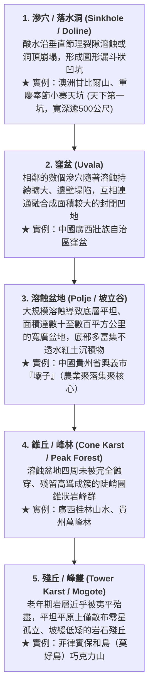
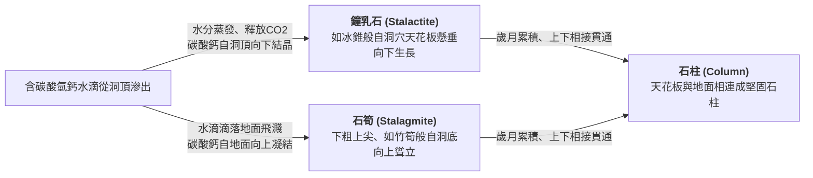
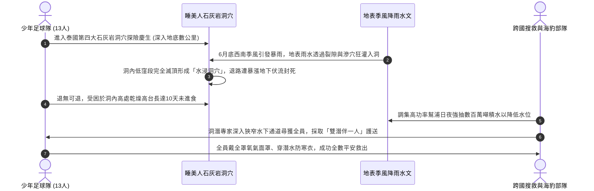

# 06. 岩溶作用與喀斯特地形（地表溶蝕、地下洞穴、睡美人洞）

:::info
**【學習重點】**
1. 掌握岩溶作用（碳酸鈣溶解與重沉澱）的化學反應機制與三大地質氣候發育條件。
2. 熟練掌握地表喀斯特地貌的演育演進序列（滲穴 $\rightarrow$ 窪盆 $\rightarrow$ 溶蝕盆地 $\rightarrow$ 錐丘 $\rightarrow$ 殘丘）。
3. 剖析地下石灰岩洞穴構造（伏流、鐘乳石、石筍、石柱）的沉積歷程。
4. 深度研讀泰國「睡美人洞」救援事件，剖析喀斯特洞穴水文特徵與野外地質探險風險。
:::

---

## 一、岩溶作用的化學機制與發育條件

在石灰岩、石膏或岩鹽等可溶性岩層廣布的地區，水與岩石發生可逆的化學溶解與沉澱反應，塑造出奇偉瑰麗的地貌，統稱為**岩溶地形**或**喀斯特地形（Karst Topography）**（得名於斯洛維尼亞喀斯特高原）。

### 1. 化學反應平衡式
$$\text{溶解溶蝕反應（侵蝕）：} \quad \mathrm{CaCO_3} \ (\text{固體石灰岩}) + \mathrm{H_2O} + \mathrm{CO_2} \longrightarrow \mathrm{Ca(HCO_3)_2} \ (\text{可溶性碳酸氫鈣水溶液})$$

$$\text{沉澱析出反應（堆積）：} \quad \mathrm{Ca(HCO_3)_2} \longrightarrow \mathrm{CaCO_3 \downarrow} \ (\text{鐘乳石沉澱結晶}) + \mathrm{H_2O} + \mathrm{CO_2 \uparrow}$$

- **溶蝕階段**：雨水在降落過程中吸收大氣二氧化碳，或滲入富含有機酸的土壤層，形成弱酸性水溶液。當其流經石灰岩裂隙時，將難溶的碳酸鈣溶解為可溶的碳酸氫鈣帶走。
- **堆積階段**：當含有碳酸氫鈣的水溶液滲入通風開闊的地下溶洞時，因壓力驟降或溫度升高，水分蒸發且二氧化碳逸出，碳酸鈣重新析出結晶。

### 2. 喀斯特地形發育的三大黃金條件
1. **可溶性厚層岩層**：地層中含有質地純厚、巨厚層的石灰岩（主要成分 $\mathrm{CaCO_3}$）。
2. **高溫多雨的氣候環境**：充沛的降水提供溶蝕動力；高溫促使植物繁茂，土壤呼吸釋放高濃度 $\mathrm{CO_2}$，大幅增強地下水的酸蝕能力。
3. **岩層節理裂隙發達且地下水位深**：地表岩石必須具備充足垂直節理，便於地表水迅速向下滲透刻蝕。

---

## 二、地表岩溶地形演育序列（由幼年至老年）

隨地質時間推移，地表石灰岩層經歷連續的溶蝕退化，展現出階梯式的地貌演育循環（圖 4-25、圖 4-26）：

:::warning
**喀斯特地區的土地利用限制：**
石灰岩區風化土層極為淺薄，且地表水極易沿裂隙快速漏失，呈現**「地表水貴如油，地下水滾滾流」**的乾旱窘境。農耕與聚落主要高度依賴地勢平坦、具保水紅土層的溶蝕盆地（西南地區俗稱**壩子**）。
:::

---

## 三、地下洞穴與沉積地形

當地下水長時間在石灰岩地層內部漫流溶蝕，會淘空形成錯綜複雜的地下宮殿——**石灰岩洞穴（溶洞）**。

### 1. 伏流（Underground River）
地表河水流經喀斯特裂隙或滲穴時完全向下滲漏，在地底暗黑管道中奔流，稱為**伏流**。中美洲馬雅文明在石灰岩高原上生活，即高度仰賴天然天井與伏流水源。

### 2. 地下沉積景觀（滴石地貌，圖 4-27）

- **世界名勝**：斯洛維尼亞**波斯托伊納溶洞（Postojna Cave）**、日本沖繩**玉泉洞**。

---

## 四、專題探討：泰國睡美人洞 18 天大救援的地質水文解析

課本 P28 專欄「來報報」詳述了 2018 年震驚全球的泰國清萊府**睡美人洞（Tham Luang Nang Non）**救援奇蹟：

### 【地理核心思維】地質環境與災害意識
1. **喀斯特水文之不可預測性**：石灰岩洞穴並非封閉水管，而是與廣大地表裂隙相通的水系匯聚管道。地表一下大雨，地下水位會在數小時內暴漲數公尺。
2. **探險風險評估**：地貌環境的利用（如觀光探險）必須嚴格順應氣候節奏，雨季期間絕不可貿然進入地下溶洞系統！

---
*上一節：[05. 河流作用與地形](05-fluvial-landforms.md) ｜ 下一節：[07. 冰河作用與地形](07-glacial-landforms.md)*
