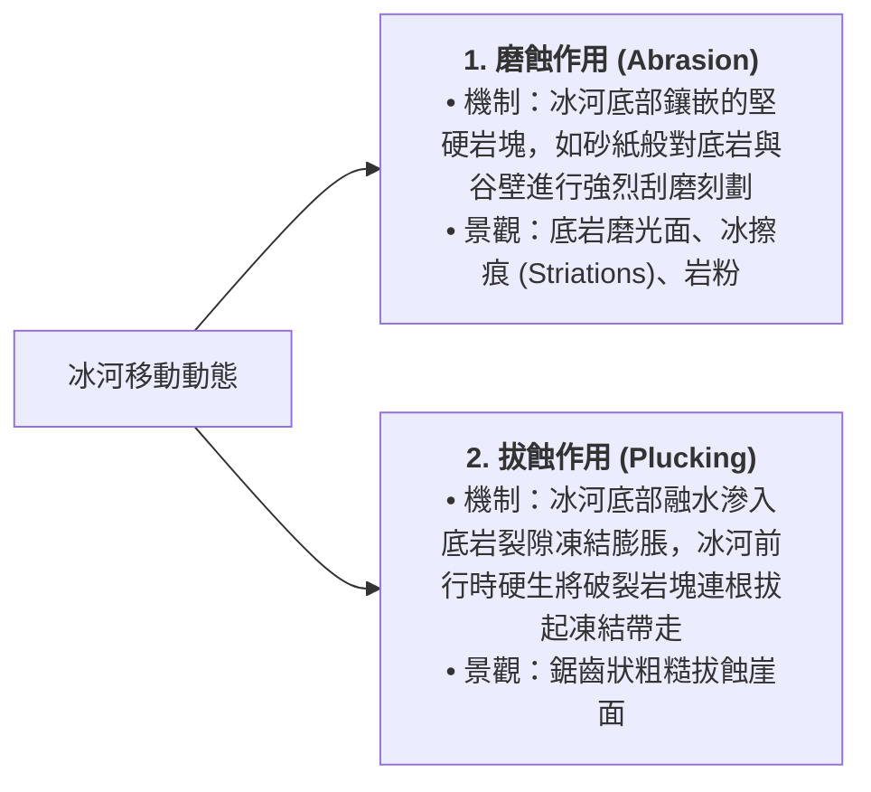
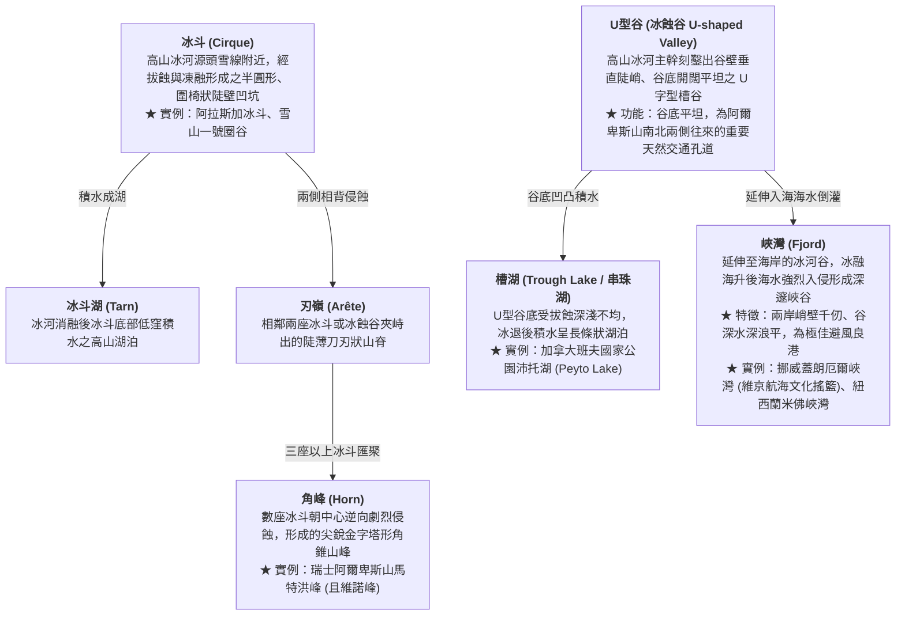
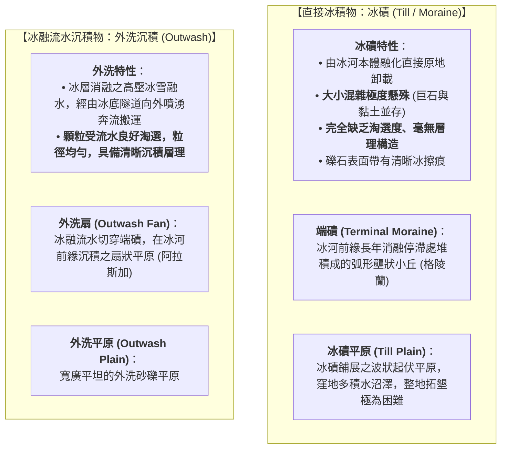

# 07. 冰河作用與地形（冰蝕、冰積、冰融流水）

:::info
**【學習重點】**
1. 掌握冰河形成的物理條件，理解「磨蝕」與「拔蝕」兩大冰蝕動力學機制。
2. 系統性辨識高山冰蝕地貌（冰斗、刃嶺、角峰、U型谷、槽湖、峽灣）之景觀特徵與等高線判別。
3. 掌握「直接冰積物（冰磧）」與「冰融流水沉積物（外洗沉積）」在粒徑分選與層理構造上的本質差異。
4. 解構歐洲第四紀大陸冰河由北往南的空間帶譜（冰蝕區 $\rightarrow$ 冰磧區 $\rightarrow$ 外洗平原 $\rightarrow$ 黃土帶）。
:::

---

## 一、冰河的誕生與運動機制

冰河被譽為地球表面「最壯麗的冰之巨龍」。目前全球約有 **10% 的陸地面積**被冰河所覆蓋（主要集中於南極大陸、格陵蘭島及全球極高山地區）。

### 1. 冰河形成條件
在終年酷寒的高緯度或雪線以上高山，年降雪量大於融雪量：
$$\text{大氣降雪} \xrightarrow{\text{層層積壓}} \text{粒雪 (Firn)} \xrightarrow{\text{空氣擠出、重結晶}} \text{緻密冰川冰 (Glacial Ice)}$$
當冰層累積厚度達數十公尺後，在地球**重力牽引**與自重塑性流動壓力下，開始順坡向低處緩慢滑移，正式誕生為**冰河（Glacier）**。

### 2. 冰蝕作用的兩大動力機制（對應課本圖 4-30）

---

## 二、冰河侵蝕地形（高山冰河景觀）

冰河質量龐大，具有遠勝流水下切的拓寬與深鑿能力，將昔日狹窄的 V 型溪谷徹底改造成雄奇的地景（圖 4-31、圖 4-32）：

---

## 三、冰河堆積地形：冰磧 vs 外洗沉積

冰河搬運物質的能力極強，但其堆積機制依「是否經過流水淘選」可截然劃分為兩大家族：

---

## 四、宏觀空間帶譜：歐洲第四紀大陸冰河分布（圖 4-34）

距今約一萬多年前的第四紀冰河時期，巨大的大陸冰層覆蓋了北歐全境。隨著氣候回暖冰河退縮，在歐洲大陸自北向南留下了極具規律的**地貌與土壤過渡帶**：

:::spoiler 點擊展開自我檢核測驗
**Q：如何從沉積物樣本一眼分辨它是「冰磧物」還是「河流沉積物」？**
- **解析**：
  1. **粒徑均勻度（淘選度）**：冰磧物顆粒大小極度混雜（從數公尺巨石到細泥均有），沒有淘選；河流沉積物經過水流分選，粒徑相當均勻。
  2. **層理有無**：冰磧物內部雜亂無章，完全沒有分層層理；河流沉積物具有明顯的水流沉積層理構造。
  3. **顆粒磨圓度**：冰磧礫石多呈稜角狀或具磨光扁平面，帶有刮痕；河流礫石經滾動多呈光滑圓潤的鵝卵石。
:::

---
*上一節：[06. 岩溶作用與喀斯特地形](06-karst-landforms.md) ｜ 下一節：[08. 探究 4-2：屏東平原水利改道與沖積扇](08-case-study-pingtung.md)*
