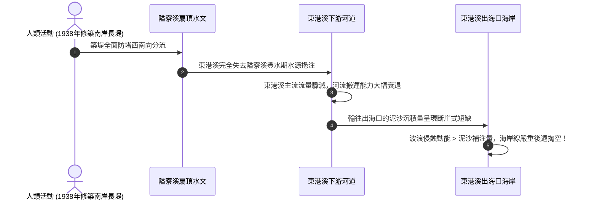

# 08. 探究 4-2：屏東平原水利改道與沖積扇演育

:::info
**【探究情境】**
位於南臺灣的屏東平原，東側緊依高聳的中央山脈，兩者交界處橫亙著構造活躍的「潮州斷層」。源自高山的隘寮溪奔流出谷，在平原上鋪展出壯闊的山麓沖積扇。日治時期一項重大的防洪導流工程，如何牽動了全流域的泥沙命脈，甚至引發數十公里外海岸線的後退劇變？
:::

---

## 一、地理背景與空間構造格局（對應課本圖 4-35）

### 1. 歷史水患與昭和 13 年（1938）改道大工程
- **早年危機**：隘寮溪為典型的荒溪型暴烈河川，每逢夏秋颱風豪雨，巨量山洪挾帶砂石在沖積扇頂任意漫流氾濫，造成下游屏東平原村落與農田嚴重水患。
- **治理策略**：臺灣總督府於日治昭和 13 年（1938年），自扇頂修築一道堅固的**「隘寮溪南岸長堤」**，強行阻斷隘寮溪向西南流向東港溪的天然分流，全面導引溪水轉向西北奔流，強迫其匯入高屏溪上游支流荖濃溪，成為荖濃溪的永久支流。

---

## 二、水利工程引發的地形系統連鎖反饋

---

## 三、課本探究提問與深度解析（對應課本 P36）

### 問題 1：潮州斷層以東山谷出口處的階地形成，應與斷層東側的地塊出現何種作用有關？
- **作答選擇**：☑ **抬升**　☐ 沉降
:::success
**【深度解析】**
斷層東側的中央山脈屬於板塊造山帶，受到菲律賓海板塊向西擠壓，**地塊處於持續構造抬升狀態**。地塊抬升導致河流的侵蝕基準面相對下降，激發河流下蝕動能，切穿早期的古沖積扇面，在谷口兩側留下一層層高拔平坦的「階地」景觀。
:::

### 問題 2：在河流流出山谷之前，中央山脈地形區內發生的哪些外營力作用有助於供應土石泥沙形成沖積扇？
- **作答選擇**：
  - ☑ **風化作用**
  - ☑ **崩壞作用**
  - ☑ **侵蝕作用**
  - ☑ **搬運作用**
  - ☐ 堆積作用
:::success
**【深度解析】**
- **風化**：高山溫差與充沛雨水促使岩石在原地崩解碎裂。
- **崩壞**：陡坡上破碎岩石在豪雨重力下拉動，引發山崩與土石流，提供巨量鬆散碎屑。
- **侵蝕**：暴雨地表逕流強烈沖刷淘削河床與兩側谷壁。
- **搬運**：湍急的湍流將崩落的巨石、泥沙高速向下游席捲搬移。
- *（註：堆積作用發生在流出谷口之後的平原區，山區內部主要為物料供應與搬離端，非堆積端）。*
:::

### 問題 3：隘寮溪堤防修築和東港溪口海岸後退的關聯，主要是圖 4-1 地形系統中哪個面向的改變所造成？
- **作答選擇**：
  - ☑ **人為活動改變外營力，進而影響形貌變化**
  - ☐ 人為活動改變內營力，進而影響形貌變化
:::success
**【核心思維結論】**
人類興修堤防、水庫等水利工程屬於**人為活動**；堤防截斷天然分流，根本改變了**地表流水（外營力介質）的水量分布與泥沙搬運物質流**；下游缺乏沙源，打破了河口「波浪侵蝕 vs 泥沙堆積」的原有動態平衡，最終導致出海口形貌退縮。這正是**「人類活動干預外營力與物質流 $\rightarrow$ 重塑地表形貌」**的經典地理實證！
:::

---
*上一節：[07. 冰河作用與地形](07-glacial-landforms.md) ｜ 下一節：[09. 風力作用與風成地形](09-aeolian-landforms.md)*
