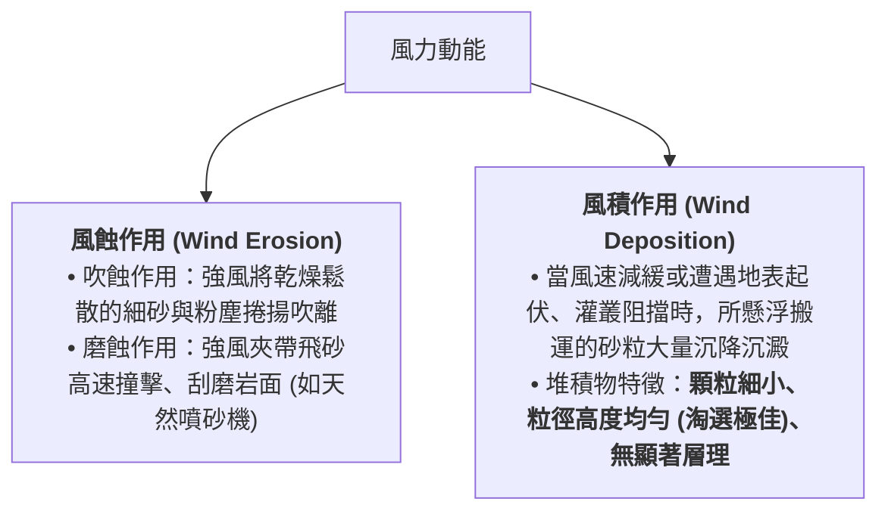
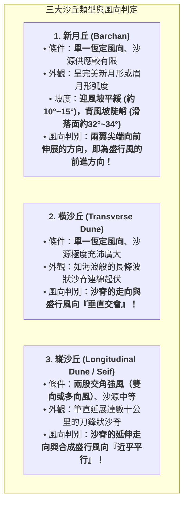
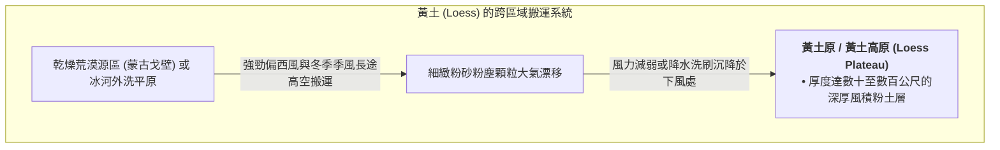

# 09. 風力作用與風成地形（風蝕、風積、黃土高原）

:::info
**【學習重點】**
1. 掌握風力作用（吹蝕、磨蝕、風積）的物理機制及其在乾燥區與濱海帶的發育條件。
2. 釐清風蝕地形演育序列（底岩 $\rightarrow$ 礫漠 $\rightarrow$ 岩漠）。
3. 掌握三大主要沙丘類型（新月丘、橫沙丘、縱沙丘）的外觀特徵與主導風向判定技巧。
4. 剖析風積黃土的成因、土壤肥力特性與中國黃土高原水土流失的人地關係。
:::

---

## 一、風力作用的營力機制

風是大氣流動產生的動能。在**氣候乾旱、植被稀疏、物理風化旺盛**的乾燥荒漠區，或是**沙源豐富的河流乾枯河床與開闊海灘**，風力成為地表最強悍的地貌雕塑師。

---

## 二、風蝕地形：礫漠與岩漠的演育

乾燥地區裸露的岩石受強烈熱脹冷縮崩解碎裂後，在強風持續吹蝕下展現階梯式地貌演進（對應課本圖 4-36）：

- **其他微型風蝕地貌**：
  - **風稜石（Ventifact）**：礫石受固定方向飛砂長期單向磨削，形成具平整切面與稜角的奇石（如臺灣富貴角、白沙灣海岸）。
  - **風蝕蕈狀岩 / 雅丹地貌（Yardang）**：基岩受下層低處高密度飛砂磨蝕掏空。

---

## 三、風積地形：沙丘形態與風向判定

在沙源持續供應處，風力堆積成各類形態多變的小丘，稱為**沙丘（Sand Dune）**。沙丘廣布的大沙漠稱為**沙質沙漠（Erg）**，例如中國新疆的塔克拉瑪干沙漠（維吾爾語意為「進得去出不來 / 沙漠下是我們的故土」）。

### 1. 三大核心沙丘類型判定技巧（對應課本圖 4-37）

### 2. 臺灣的代表性沙丘景觀
- **桃園草漯沙丘**：位於大園區至觀音區沿海，被譽為「台版撒哈拉沙漠」。冬季強烈**東北季風**吹拂海灘豐富的河川沖積砂粒，在海岸後方堆積成高達 10~15 公尺的高聳海岸沙丘群，具備阻擋風浪入侵的天然防護屏障功能。
- **屏東恆春風吹砂**：冬季落山風（強勁下坡風）將沙粒由海邊往懸崖上方吹送，形成罕見的崖頂風積沙丘。

---

## 四、風積黃土與黃土高原（圖 4-38、照片 4-21）

### 1. 黃土的物理化學特性與農業奇蹟
- **富含碳酸鈣等礦物鹽類**：由多種母岩風化而來，天然養分極佳，只要配合適當水源灌溉，土質非常肥沃，利於早期農耕文明開展（如黃土高原渭河盆地自西周至唐代長達一千餘年成為帝國首都樞紐）。
- **粒徑細緻、孔隙度高且具「垂直節理」**：先民易於利用其垂直自立特性開鑿「窯洞」居住，冬暖夏涼。

### 2. 黃土環境的生態脆弱性與限制
- **致命弱點：水土流失與千溝萬壑**：黃土顆粒膠結極弱，一旦地表森林植被遭過度砍伐破壞，遭遇夏季暴雨沖刷，極易引發崩塌與劇烈侵蝕，形成溝壑縱橫、殘原破碎的脆弱生態地貌，亦是下游黃河泥沙暴增、下游氾濫改道的根本源頭。

---
*上一節：[08. 探究 4-2：屏東平原水利改道](08-case-study-pingtung.md) ｜ 下一節：[10. 海水作用與海岸地形](10-coastal-landforms.md)*
