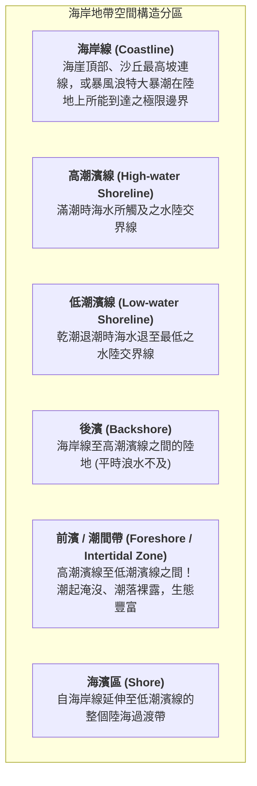
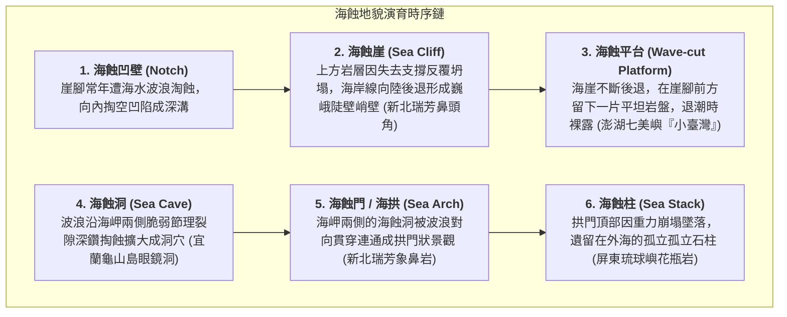
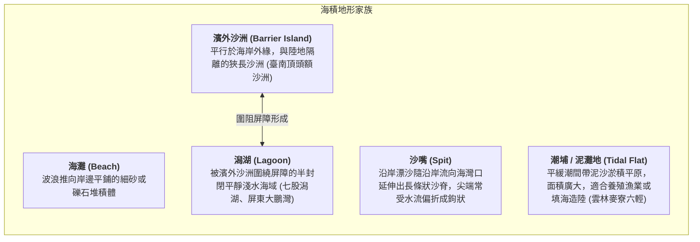

# 10. 海水作用與海岸地形（海蝕、海積、離水與沉水）

:::info
**【學習重點】**
1. 掌握波浪、沿岸流與潮汐之水力作用，明確區分海岸線、濱線、前濱（潮間帶）與海濱區之空間界線。
2. 系統掌握岩岸「海蝕地形演育鏈」（海蝕凹壁 $\rightarrow$ 海蝕崖 $\rightarrow$ 海蝕平台 $\rightarrow$ 海蝕洞 $\rightarrow$ 海蝕門 $\rightarrow$ 海蝕柱）。
3. 掌握沙岸「海積地形景觀」（海灘、沙嘴、潮埔、濱外沙洲、潟湖）的空間組合與人地利用。
4. 深度對比地殼垂直升降塑造之「離水海岸（海階）」與「沉水海岸（谷灣、峽灣）」。
:::

---

## 一、海岸地帶空間分區與水力營力

海岸地帶是陸地、大氣與海洋交會碰撞的前線，受到波浪（Wave）、沿岸流（Longshore Current）與潮汐（Tide）永不停歇的交互洗禮。

### 1. 海岸帶核心空間名詞界定（對應課本圖 4-39）

---

## 二、海蝕地形（岩岸地形演育鏈）

波浪拍擊岩岸時，巨大的水壓動能與夾帶的礫石強烈撞擊破裂面，誘發連鎖式的地貌崩塌演育（對應課本圖 4-41、照片 4-23）：

- **岬灣海岸（Headland and Bay）**：因岩層軟硬交錯排列，經海水差異侵蝕後，硬岩突出成海岬（野柳岬、鼻頭角、三貂角），軟岩受蝕凹入成灣澳（深澳、澳底）。灣澳內波浪微弱，成為天然避風港與漁村發祥地。

---

## 三、海積地形（沙岸景觀與資源利用）

當波浪與沿岸流推上陸地的泥沙堆積量，大於被水流帶走的數量時，海積地形便應運而生（對應課本圖 4-42、4-43、照片 4-24）：

---

## 四、地殼垂直升降：離水海岸 vs 沉水海岸

陸地地殼相對地幔的構造抬升或下沉，或是全球冰河期引發的海平面升降，會深刻改變海岸輪廓（圖 4-44、4-45、4-46）：

| 海岸類別 | 離水海岸 (Emergent Coast) | 沉水海岸 (Submergent Coast) |
| :--- | :--- | :--- |
| **地體升降相對關係** | **陸地相對上升** 或 **海平面相對下降** | **陸地相對下沉** 或 **海平面相對上升** |
| **海岸輪廓線特徵** | 原海底平坦地形裸露，海岸線平直單調（除非前身為岩岸） | 海水湧入陸地山谷，**海岸線極為曲折破碎、岬灣島嶼密布** |
| **核心代表地貌** | **海階（Marine Terrace）**：舊海蝕平台抬升脫離浪擊；高懸的**離水海蝕洞**、**離水海蝕崖** | 1. **谷灣海岸（Ria Coast）**：山谷淹水成海灣，山脊凸出成岬角或島嶼（中國閩浙海岸）。 2. **峽灣海岸（Fjord Coast）**：冰蝕U型谷淹水成深海灣（挪威峽灣）。 |
| **臺灣與全球代表實例** | 臺灣東部海岸（花蓮縣豐濱鄉**石梯坪**海階群、臺東八仙洞離水洞穴） | 中國福建與浙江沿海、日本三陸海岸、挪威西海岸 |

:::tip
**等高線判讀秘訣：**
- **海階**：等高線出現「疏（平坦海階面） $\rightarrow$ 密（海階崖） $\rightarrow$ 疏（上一層海階面）」的規律平行階梯帶。
- **谷灣海岸**：等高線呈現密集「V 字型朝陸地內縮」的深曲溺谷群，外海散布無數封閉等高線環形島礁。
:::

---
*上一節：[09. 風力作用與風成地形](09-aeolian-landforms.md) ｜ 下一節：[11. 探究 4-3：桃園海岸線後退與環境變遷](11-case-study-taoyuan.md)*
