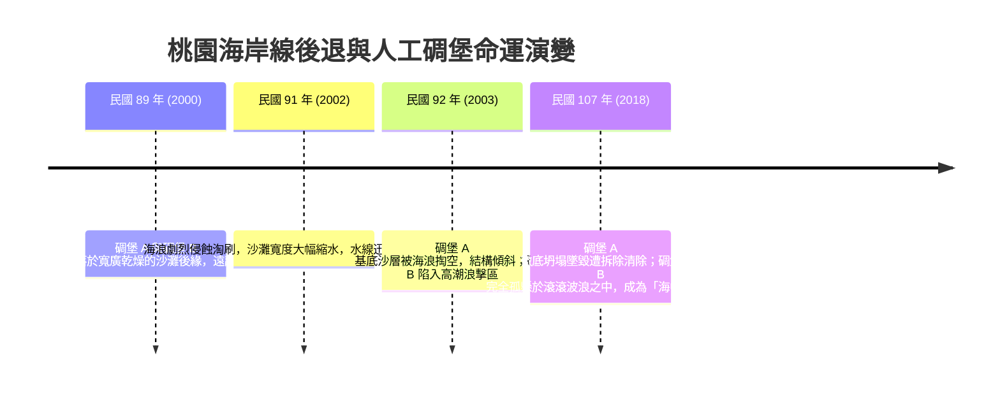

# 11. 探究 4-3：桃園海岸線後退與環境變遷

:::info
**【探究情境】**
桃園市大園區、觀音區至新屋區一帶的西北海岸，曾擁有浩瀚寬廣的沙灘與壯麗沙丘。然而，數十年來，這裡卻成了臺灣本島海岸線「侵蝕後退最嚴重」的紅色警戒區！原本矗立在乾燥陸地上的海防軍事碉堡，竟在海浪拍擊下一步步沉入海中……
:::

---

## 一、影像證據：海防碉堡的「泡水」編年史（照片 4-25）

早期國軍在西北海岸沙灘高處修築了堅固的鋼筋混凝土海防軍事碉堡。比對民國 60 年代至 107 年間的航空照片與現場觀測，碉堡成了海岸線急速後退的最真實活見證：

---

## 二、課本探究提問與深度解析（對應課本 P47）

### 問題 1：藉由觀察海岸物質的組成，判斷此區屬於哪種海岸類型？
:::success
**【參考解答】**
屬於**沙岸（沙質海岸 / 礫沙海岸）**。  
此區地表主要由鬆散的細砂、礫石及風積沙丘組成，缺乏基岩露頭的海崖或海蝕平台，為典型由河流沖積物與沿岸漂沙沉積塑成的沉積型沙質海岸。
:::

### 問題 2：依據照片 4-25，有哪些明確證據可以顯示此區海岸發生了嚴重的後退現象？
:::success
**【參考解答】**
1. **人工建物與水線相對位置劇烈位移**：民國 89 年碉堡 A 與 B 均建於平坦沙灘高處陸地；至民國 92 年基座被掏空傾倒；民國 107 年碉堡 B 已完全浸泡於海水波浪中，證明水陸邊界（濱線）向陸地大幅退縮數十公尺。
2. **沙灘寬度急遽萎縮**：照片中可見原先寬闊平緩的海灘緩衝帶隨年代推移幾乎消失殆盡。
3. **地物毀損消失**：碉堡 A 因侵蝕掏空崩毀，最終被迫由政府工程清除。
:::

### 問題 3：海岸地帶的快速退縮變化，對於當地居民與環境可能帶來哪些嚴重影響？
:::warning
**【衝擊影響多面向分析】**
1. **國土流失與私有地消失**：陸地面積直接縮減，沿海農田、魚塭及濱海保安林遭到海水強行吞噬。
2. **天然防護屏障瓦解，加劇水患威脅**：昔日海岸沙丘與寬闊海灘是抵禦暴潮的天然消波墊；海灘流失後，颱風與大潮長驅直入，巨浪直擊海堤，極易造成海堤潰決、內陸低窪聚落大規模海水倒灌。
3. **地下水與農地鹽化**：海水水位逼近內陸，加劇沿海地下水水質鹽化，使周遭農作物枯萎，農地無法耕作。
4. **基礎設施受損**：濱海公路地基面臨淘空危機，沿海養殖業管線與抽水設施頻繁遭海浪破壞，維修成本激增。
:::

---

## 三、延伸探討：西北海岸侵蝕加劇的幕後元凶

桃園海岸線何以陷入「吃泥沙不足」的飢渴困境？
- **上游攔水攔砂**：石門水庫等水利設施大量截留了大漢溪上游的泥沙，導致輸出至海岸的砂源大減。
- **人工港灣突堤效應**：沿海開闢工業港、防波堤垂直凸出海岸，阻斷沿岸流自北向南搬運漂沙的路徑，導致背流側海岸泥沙完全斷供。
- **過度抽砂與氣候變遷**：早期沿海抽砂造地，配合極端氣候風暴潮頻仍與海平面微升，使得海岸侵蝕雪上加霜。

---
*上一節：[10. 海水作用與海岸地形](10-coastal-landforms.md) ｜ 下一節：[12. 地形系統與人類生活](12-human-environment.md)*
