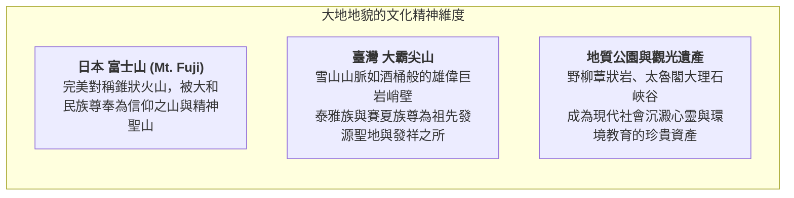
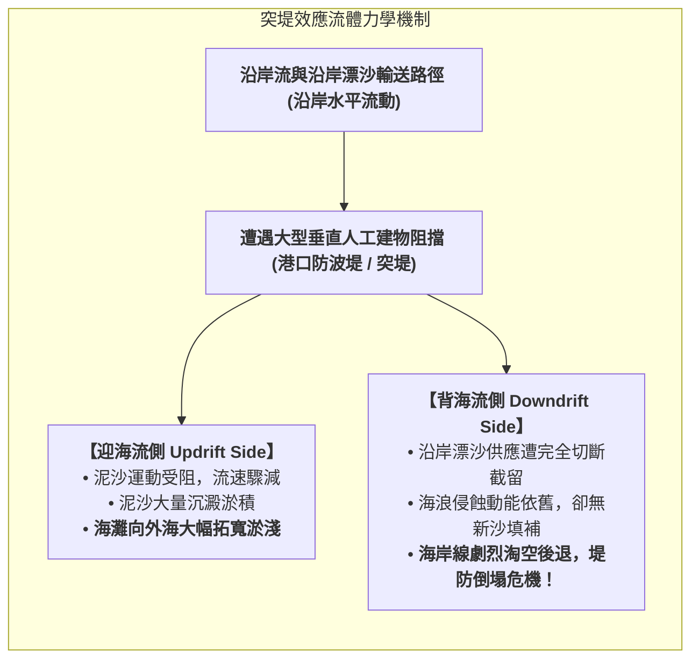
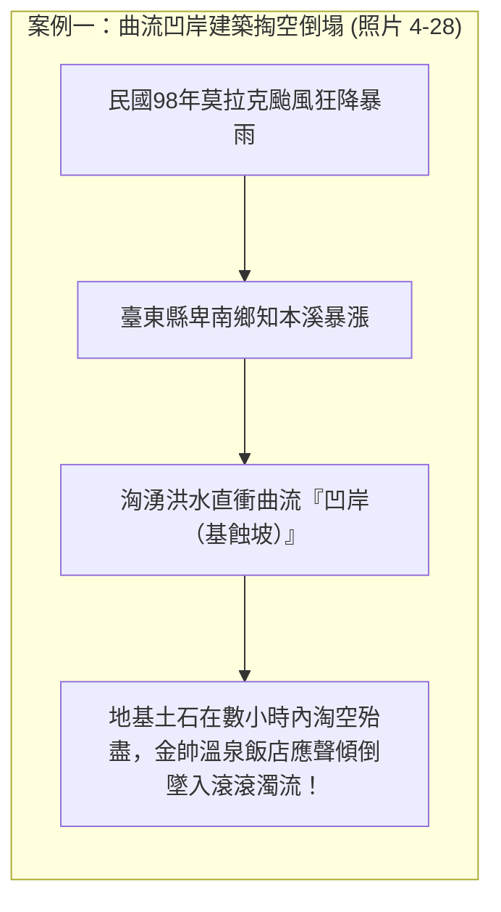
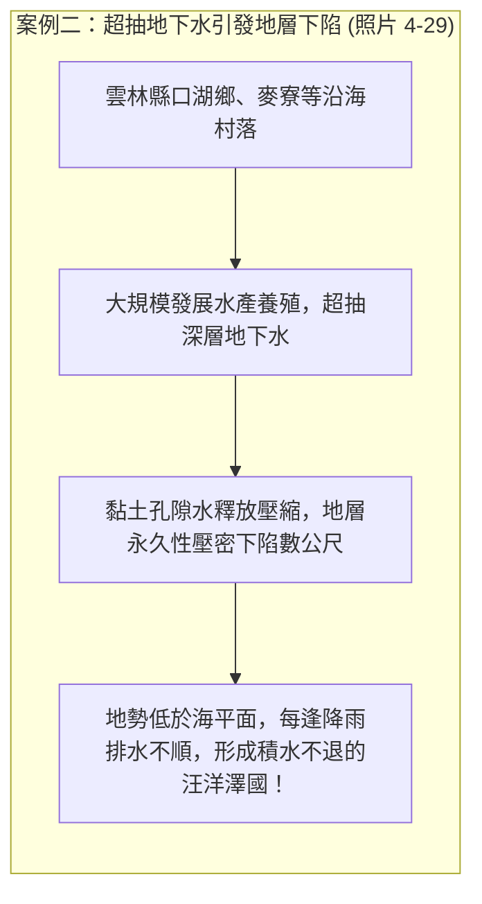

# 12. 地形系統與人類生活（人地關係、突堤效應、災害調適）

:::info
**【學習重點】**
1. 體會地形景觀超越物質利用的精神文化意義（聖山信仰與地質觀光遺產）。
2. 透徹掌握海岸工程「突堤效應（Jetty Effect）」的流體力學機制與迎背流側差異。
3. 剖析人類不當利用加劇地形災害的真實血淚案例（知本溪曲流凹岸倒塌、雲林口湖地層下陷）。
4. 建立臺灣島嶼環境下「理解地形演育極限、實現人地永續調適」的現代國土利用觀念。
:::

---

## 一、超越物質：地形的精神象徵與文化聖地

人類與地形系統的連結，絕非僅限於農耕、取水等實用功能。高聳巍峨、形態奇絕的大自然地貌，自古以來便喚起人類靈魂深處的敬畏與靈性共鳴：

---

## 二、人為工程對地形系統的干擾：突堤效應（Jetty Effect）

當人類試圖用剛性水泥結構物征服海岸時，往往不自覺地打破了海岸漂沙系統的精妙平衡（對應課本圖 4-47）：

:::warning
**臺灣真實案例：**
- 新竹漁港防波堤興建後，南側海灘失去沙源，海岸線急遽後退侵蝕。
- 宜蘭烏石港突堤修築後，北側外澳海灘大量積沙淤淺，南側海灘則面臨淘空。
:::

---

## 三、漠視地形規律帶來的災害反噬

人類若在缺乏對地形演育機制的理解下盲目開發，大自然的營力便會以毀滅性的災害進行反撲：

---

## 四、臺灣的環境省思與永續地形調適

在人口稠密、山多平原少（山地丘陵占全島逾 70%）的臺灣，土地資源彌足珍貴。將所有敏感地形完全圈禁棄之不用，在現實社會經濟中難以全面落實。

:::info
**【國土永續的核心思維】**
1. **尊重大地規律**：開發前必須建立嚴密的地質與水文調查，避開活動斷層帶、土石流潛勢溪流扇頂、順向坡走山高危險區及曲流強烈沖刷之凹岸。
2. **揚棄人定勝天哲學**：避免過度依賴硬體水泥工程（如築高牆抗暴潮），改採**「以自然為本的解方（Nature-based Solutions, NbS）」**，例如營造海岸紅樹林、保留天然沙丘與消波泥灘、落實河川流域還地於河。
3. **動態監測與調適管理**：利用現代遙測技術、無人機與 Web GIS 平台監測地貌位移，學習與動態的地形系統和平共榮！
:::

---
*上一節：[11. 探究 4-3：桃園海岸線後退](11-case-study-taoyuan.md) ｜ 下一節：[13. 活動GO：臺灣堡圖與地名中的地形密碼](13-activity-taiwan-toponyms.md)*
