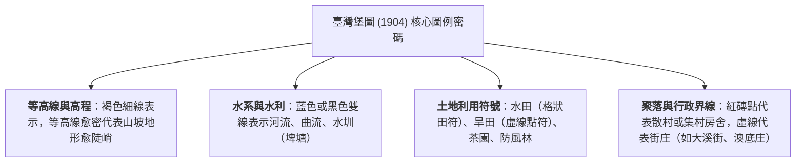

# 13. 活動GO：臺灣堡圖與地名中的地形密碼

:::info
**【活動設計理念】**
臺灣先民在土地拓墾的歲月中，習慣「因地制宜、望地命名」。生活空間中的聚落名稱，往往凝結了最真實的地貌地質特徵。本活動引導同學結合 1904 年日治時期繪製的精準測繪巨作——**《臺灣堡圖》**，解碼地名中隱藏的地形密碼，並利用現代 Web GIS 探究鄉土地理！
:::

---

## 一、地圖工具解碼：1904 年《臺灣堡圖》圖例判讀（圖 4-48）

《臺灣堡圖》是臺灣歷史上首次採用現代三角測量與等高線法繪製的二萬分之一定形圖：

---

## 二、地名案例深入探究學習單（課本 P52～P54 完整解答）

以下針對課本所列臺灣五大經典地形聚落地名，進行系統性解構：

### 案例 1：澳底（新北市貢寮區）
- **代表地形字詞**：**「澳」**
- **1. 地形字詞代表意義**：指深入陸地、水面相對平靜深邃的**海灣**。
- **2. 地形類型與營力**：**海蝕岬灣海岸（灣澳）**；海水波浪對軟弱沉積岩層的**差異侵蝕作用**。
- **3. 地形優勢與產業活動**：灣澳兩側有海岬遮蔽冬季強烈東北季風與大浪，水深浪平，為絕佳**避風港口**；極利於發展沿近海**漁業**、九孔與紫菜養殖業及海鮮觀光。
- **4. 潛在災害與發展限制**：遭遇颱風暴潮或突發長浪（瘋狗浪）襲擊；聚落背後緊鄰雪山山脈陡峭山丘，**陸域腹地極為有限**，交通拓寬受阻。

---

### 案例 2：四鯤鯓（臺南市南區）
- **代表地形字詞**：**「鯤鯓」**（臺語發音：khun-sin）
- **1. 地形字詞代表意義**：源自古代傳說大魚「鯤」，比喻在海浪中隆起、**形如鯨魚脊背的狹長海中沙洲**。
- **2. 地形類型與營力**：**海積地形（濱外沙洲與潟湖）**；波浪與沿岸流自河流出海口搬運泥沙進行的**海積作用**。
- **3. 地形優勢與產業活動**：沙洲在外圍築起天然屏障，使內側水域（古台江內海、安平海域）波平浪靜；早期先民廣泛利用於**牡蠣（蚵田）養殖、魚塭水產養殖與鹽田曬鹽**。
- **4. 潛在災害與發展限制**：沙洲地勢極度低平，排水不易，夏季常面臨**颱風暴潮海水倒灌與內澇水患**；沙洲易受波浪拍擊淘空而變形漂移。

---

### 案例 3：三層（桃園市大溪區）
- **代表地形字詞**：**「層」**
- **1. 地形字詞代表意義**：指平坦地面如同階梯一般，**一層高過一層的台狀階地**。
- **2. 地形類型與營力**：**河流地形（河階）**；地殼構造間歇性上升或侵蝕基準面下降，大漢溪流水重新強烈**下蝕切割舊河床**。
- **3. 地形優勢與產業活動**：**河階面平坦開闊，鄰近水源，且高於現今河道數十公尺，絕無洪水滅頂之虞**；極宜於開闢梯田聚落、發展**水稻種植與茶園**。
- **4. 潛在災害與發展限制**：河階崖邊坡陡峭，暴雨期有**落石崩塌**風險；各層階面間高程落差巨大，階地間交通垂直爬坡困難，高位河階水圳引水較不易。

---

### 案例 4：灣仔（臺北市中山區）
- **代表地形字詞**：**「灣」**
- **1. 地形字詞代表意義**：指河流流路轉折處的**河灣、水灣**（曲流處）。
- **2. 地形類型與營力**：**河流共同作用地形（曲流凸岸與凹岸 / 氾濫平原）**；基隆河流水的**側蝕沖刷與泥沙淤積堆積**。
- **3. 地形優勢與產業活動**：地勢開闊，河流沖積土層肥沃，水源充足；深水處可設水運**渡口碼頭**，平緩處利於**早期水稻農業**開墾。
- **4. 潛在災害與發展限制**：位於曲流擺盪氾濫區，昔日每逢颱風暴雨，基隆河極易漫溢造成**嚴重水災淹水**（後於民國80年代推動基隆河截彎取直工程）。

---

### 案例 5：沙崙（桃園市大園區）
- **代表地形字詞**：**「崙」**
- **1. 地形字詞代表意義**：閩南語指地表圓形隆起的**小沙丘或孤立土丘**。
- **2. 地形類型與營力**：**風積地形（海岸沙丘）**；強勁東北季風吹揚海灘沉積沙粒的**風積作用**。
- **3. 地形優勢與產業活動**：沙丘隆起可作為阻擋海風、鹽沫侵襲的**天然防風屏障**；多栽植木麻黃防風林、開闢**耐旱作物田或濱海休閒景觀**。
- **4. 潛在災害與發展限制**：冬季強風引發**飛沙危害**，掩埋農田灌溉溝渠與道路；沙質土壤孔隙大、保水保肥力極差，乾旱嚴重。

---

## 三、自主探究實作報告指引（課本 P54 學習歷程檔案）

同學們可選擇自家住家、學校周遭或祖父母故鄉帶有地形特徵的地名（如：內湖之「湖」、大坑之「坑」、草坪之「坪」、崎頂之「崎」、崁腳之「崁」），利用以下三大官方權威 Web GIS 平台進行時空套疊分析：

### 推薦數位工具與 Web GIS 平台清單：
1. **內政部地名資訊服務網**  
   - 網址：[http://gn.moi.gov.tw/GeoNames/index.aspx](http://gn.moi.gov.tw/GeoNames/index.aspx)  
   - 功能：查詢全臺歷史老地名沿革、閩客原住民命名由來與座標。
2. **中研院地理資訊科學研究專題中心：臺灣百年歷史地圖**  
   - 網址：[http://gissrv4.sinica.edu.tw/gis/twhgis/](http://gissrv4.sinica.edu.tw/gis/twhgis/)  
   - 功能：將 1904 年臺灣堡圖與現代高解析度正射衛星影像進行滑動式比對，透視百年地貌演變。
3. **國家災害防救科技中心 (NCDR) 災害潛勢地圖**  
   - 網址：[https://dmap.ncdr.nat.gov.tw/](https://dmap.ncdr.nat.gov.tw/)  
   - 功能：套疊淹水潛勢圖、土石流潛勢溪流、活動斷層與地質敏感區，診斷家鄉地貌的安全韌性！

---
*上一節：[12. 地形系統與人類生活](12-human-environment.md) ｜ 下一節：[14. 附錄：核心名詞對照表與學習評量](14-appendix-glossary-quiz.md)*
