# 高中地理（全）：第四章 地形系統 (Geomorphological Systems)

> **教育部 108 課綱普通型高級中學地理科教材**  
> **單篇完整版 (All-in-One Full Edition) ｜ 支援 HackMD 書本模式與一鍵匯出**

[TOC]

---


# 00. 章首導讀：地形系統概念與人地互動

:::info
**【核心思辨】地形系統的變遷，對人類而言究竟是帶來資源，還是帶來災害？**
地表是人類文明發展的舞臺。本章將帶領同學從「系統（System）」的宏觀視角，透視地表起伏變化的營力機制，並反思人類與動態地形環境之間的永續共存之道。
:::

---

## 一、情境導讀：從台江滄海到七股桑田

站在**臺南市七股區**曾文溪出海口北岸的**頂頭額沙洲**上，矗立著臺灣本島極西點——**國聖燈塔**。望向內側，是波光粼粼的**七股潟湖**，蚵架井然有序；望向外側，則是臺灣海峽洶湧的波浪。

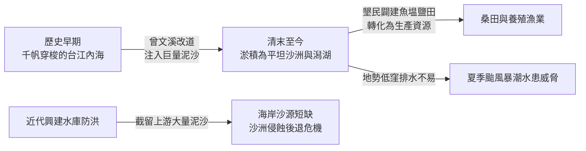

這片土地的歷史，正是地形系統動態演育與人地互動的典型縮影：
1. **滄海變桑田（資源獲取）**：昔日為千帆穿梭的台江內海，後因曾文溪多次改道帶來龐大泥沙，泥沙在波浪與沿岸流搬運堆積下，使內海迅速淤積成陸地與沙洲，先民得以開墾農田、闢建魚塭與鹽田。
2. **水患威脅（環境限制）**：新生地地勢低窪，排水不良，每逢夏季暴雨與颱風暴潮，洪澇災害便成為沿海居民的沉重威脅。
3. **人為干預的連鎖反應（系統反饋）**：晚近政府為治理水患與供應用水，於河流上游興建多座水庫，雖顯著減緩了下游水患，卻也截留了大量隨水流下的泥沙，造成河口沙源供應銳減。缺乏泥沙補充的濱外沙洲在海浪持續拍擊下逐漸被淘空後退，威脅七股潟湖的養殖漁業及極西點沙洲的保存。

---

## 二、地表舞台：大尺度與小尺度的景觀交織

地表擁有千變萬化的起伏形態：
- **大尺度地形（Macro-scale）**：涵蓋橫亙數千公里的山脈、廣闊的高原、封閉的盆地、低緩的丘陵與平坦的平原。例如聳入雲霄的臺灣中央山脈、世界屋脊喜馬拉雅山脈。
- **小尺度微地形（Micro-scale）**：聚焦於局部特定營力塑造的細緻景觀，如迎風堆積的沙丘、受波浪與風化雕琢的蕈狀岩、高山寒凍崩落的碎石坡、地下溶洞內滴凝而成的鐘乳石。

不同的空間尺度，背後運作的營力類型、影響的時間範疇各不相同，但彼此緊密交扣，共同構成了人類生活的立體舞臺。

---

## 三、何謂「地形系統（Geomorphic System）」？

所謂**系統（System）**，是指由一組相互依存、共同運作的組成單元（Components），藉由**能量（Energy）**與**物質（Matter）**的流動與轉換而相互關聯的整體。

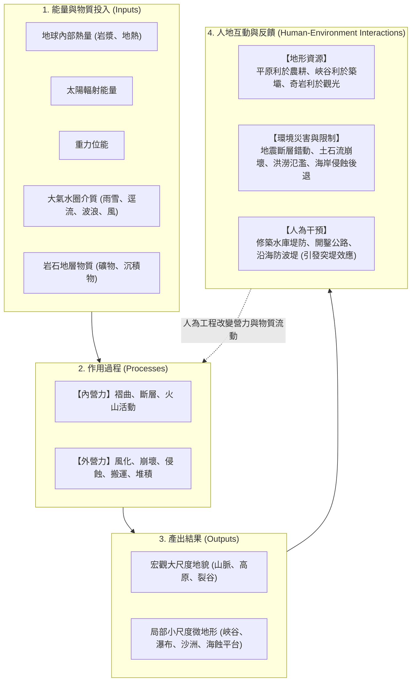

:::warning
**人地雙向省思：開發與風險的平衡**
- 在山區開闢景觀公路固然促進交通與觀光，但削切邊坡破壞平衡，是否埋下了土石崩塌與山崩的隱患？
- 濱海奇岩怪石創造了龐大的遊憩商機，但駐足遊客是否意識到瘋狗浪與岩石落石的潛在致命危機？
- 河川築堤束水保護了堤內社區，卻是否使得河床泥沙淤高、出海口沙源中斷？
:::

---

## 四、本章學習導航與核心素養

本章內容劃分為三大核心主軸與一項專題地理實作：

| 學習節次 | 核心探討主題 | 聚焦重要概念與在地/全球實例 |
| :--- | :--- | :--- |
| **第一節 地形系統與營力** | 地形運作概念、內營力與外營力機制 | 褶曲（背斜向斜）、斷層（地壘地塹）、火山（基隆山/澎湖柱狀玄武岩/維蘇威）、物理/化學風化、四大崩壞類型、差異侵蝕、**探究 4-1 野柳女王頭** |
| **第二節 流水、岩溶與冰河塑造的地形** | 外營力三大主力雕琢之陸地景觀 | 河流三向侵蝕、侵蝕基準面、沖積扇湧泉帶（五溝水）、氾濫平原、曲流與牛軛湖、河階（大溪）、喀斯特地下洞穴（泰國睡美人洞）、冰蝕與冰積地形、**探究 4-2 屏東平原水利改道** |
| **第三節 風、波浪塑造的地形與辨識** | 乾燥與濱海交會處之地貌動態 | 風蝕（礫漠岩漠）、風積沙丘（草漯沙丘）與黃土高原、海蝕地貌、海積沙洲潟湖、離水海階（石梯坪） vs 沉水谷灣、突堤效應、**探究 4-3 桃園海岸侵蝕後退** |
| **活動篇 地理實作 GO** | 1904 臺灣堡圖與地名中的地形密碼 | 空間資訊判讀、澳底（灣澳）、四鯤鯓（沙洲）、三層（河階）、灣仔（曲流）、沙崙（沙丘）之生活地名與環境智識 |

---
*下一節：[01. 地形系統的概念與空間尺度](01-geomorphic-systems.md)*


---


# 01. 地形系統的概念與空間尺度

:::info
**【學習重點】**
1. 理解「系統」的科學意涵，掌握地形系統中「能量投入 $\rightarrow$ 營力作用 $\rightarrow$ 地形產出 $\rightarrow$ 人類活動」的運作機制。
2. 釐清內營力與外營力的根本能量來源、作用速度與空間規模差異。
3. 掌握地形學中的「空間尺度（Spatial Scale）」思維，學會從微觀沙丘視角跨越到宏觀全球氣候與板塊分布。
:::

---

## 一、什麼是地形系統？

地表不是靜止不變的死寂外殼，而是一個隨時處於物質轉換與能量流動中的**動態開放系統**。

### 1. 系統的核心定義
**系統（System）**是指由一組具有特定關聯性的物體、要素或現象所構成的有機整體。組成系統的各單元之間，藉由**能量的流動**與**物質的轉移**緊密相繫。

### 2. 地形系統運作架構（對應課本圖 4-1）

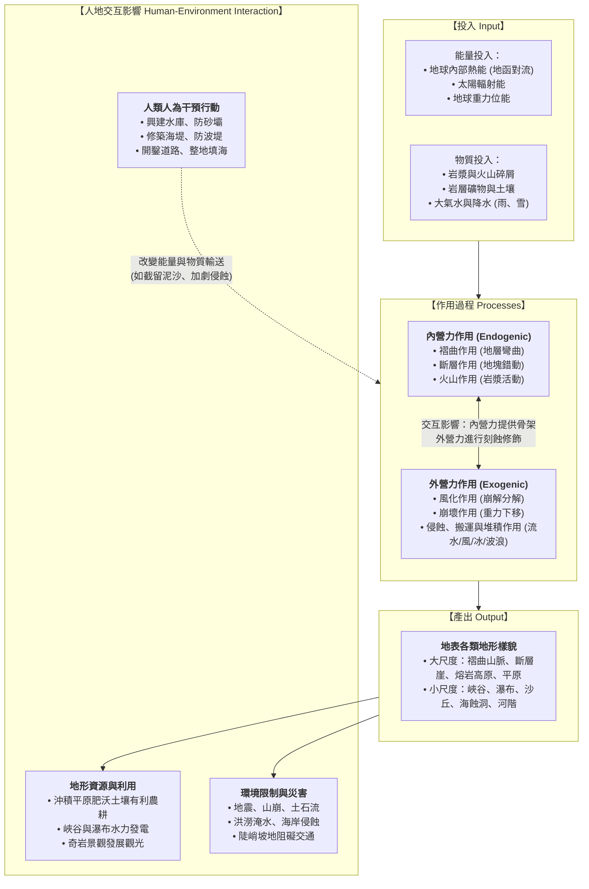

---

## 二、內營力與外營力的比較

形塑地表形態的兩大核心推手為**內營力**與**外營力**，兩者的對比如下表所示：

| 比較項目 | 內營力 (Endogenic Forces) | 外營力 (Exogenic Forces) |
| :--- | :--- | :--- |
| **主要能量來源** | **地球內部熱量**（放射性元素衰變、地函對流、地心殘存高熱） | **太陽輻射能量**（驅動水循環與大氣環流）與**地球重力** |
| **主要運作介質** | 岩漿、地函熱柱、地殼板塊岩石層 | 地表流水、地下水、冰河、海水波浪/沿岸流、風、生物 |
| **核心作用形式** | 褶曲作用、斷層作用、火山作用、板塊造山運動 | 風化、崩壞、侵蝕、搬運、堆積作用 |
| **空間影響範圍** | **廣大（大尺度為主）**，常涵蓋數千公里山脈或地塊 | **局部至中微尺度**，但長期普遍作用於整個地表 |
| **塑造地形之角色** | **形塑地表的基本骨架與構造**（奠定粗胚大輪廓） | **雕琢細部形態的雕塑師**（削平高山、填平低窪） |
| **作用時間與速度** | 造山運動常需數百萬年；火山噴發與地震斷層則為瞬間突發 | 既有暴雨洪澇、土石流的瞬間破壞，亦有千年滴水穿石的緩慢演育 |

:::info
**重要觀念提醒：**
地表任何一處地形，都不是單一營力獨立塑造的產物，而是**內營力奠定骨架後，外營力接續或同時進行雕琢改造的連續性動態平衡**。
:::

---

## 三、地形系統的空間尺度（Spatial Scale）

在地形學的探討中，「尺度」是解開地景之謎的關鍵金鑰。課本以「沙丘與沙漠」為例（圖 4-2），展示了不同尺度下地理學家提出的提問視角：


### 1. 小尺度微地形的觀察提問
當我們身處局部沙丘時，關注重點在於**直接營力的物理機制與當前形態**：
- 這座沙丘高度有多高？迎風坡與背風坡的坡度有何差異？
- 風向與風速如何搬運沙粒？沙丘會隨時間移動嗎？
- 為什麼沙丘表面缺乏植被生長？（保水不易、基質流動性高）
- 這些細沙的源頭從何而來？（鄰近河流沉積物或底岩風化）

### 2. 大尺度宏觀系統的探究提問
當我們將視野拉升至衛星與全球地圖時，提問轉向**宏觀氣候動力與地體構造格局**：
- 為什麼撒哈拉沙漠橫跨北非？為什麼納米比沙漠集中在非洲西南部？（受副熱帶高壓帶下沉氣流、沿岸本吉拉涼流降溫減濕影響）
- 沙丘僅能在熱帶沙漠中發現嗎？（否，臺灣西海岸如草漯沙丘、高緯度冰河外洗區亦可見沙丘）
- 全球各大洲的沙漠分布是否具備對稱性與規律性？

:::spoiler 點擊展開：尺度思維在學習上的應用
地理學的思維核心在於「**拉遠能看全局格局，拉近能析物理機轉**」。面對同一種地形，切勿只背誦名稱，應學會切換尺度思考其地質年代背景、宏觀氣候控制，以及局部的營力力學行為！
:::

---
*上一節：[00. 章首導讀](00-introduction.md) ｜ 下一節：[02. 內營力與地形演育](02-endogenic-processes.md)*


---


# 02. 內營力與地形演育（褶曲、斷層、火山）

:::info
**【學習重點】**
1. 掌握地函對流驅動板塊運動，如何透過「褶曲」、「斷層」、「火山」奠定全球大尺度地貌架構。
2. 辨識背斜與向斜、地壘與地塹、斷層崖之構造特徵與實例。
3. 對比「寧靜式噴發」與「猛烈式噴發」的岩漿性質（二氧化矽含量、黏度）、火山體形態與景觀。
4. 深度剖析火山活動對人類社會帶來的「災害危機」與「資源利基」。
:::

---

## 一、內營力之源：板塊構造與能量驅動

內營力的根本動力源自**地球內部的熱能**。地函深處的放射性同位素衰變釋放高熱，引發地函物質產生緩慢的**熱對流（Mantle Convection）**，進而帶動上方剛硬的岩石圈板塊相互分離、擠壓或錯動。

板塊邊界的強烈變形，在地表留下三種關鍵的構造地形：
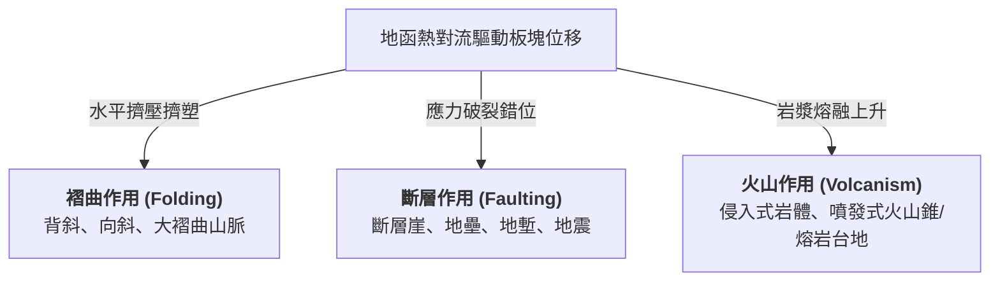

---

## 二、褶曲作用（Folding）

### 1. 作用機制與構造名詞
當原本水平堆積的沉積岩層受到板塊**水平擠壓力**作用，在未達破裂強度前產生塑性變形，呈現波浪起伏的彎曲形態，稱為**褶曲（Fold）**。

```mermaid
graph LR
    subgraph Fold["褶曲構造受力示意"]
        P1["擠壓力 ➔"] --> Ant["<b>背斜 (Anticline)</b><br>地層向上隆起凸起<br>核部岩層年代較老"]
        Ant --> Syn["<b>向斜 (Syncline)</b><br>地層向下凹陷彎曲<br>核部岩層年代較新"]
        Syn <-- P2["⬅ 擠壓力"]
    end
```

### 2. 褶曲山脈與造山運動
在板塊隱沒或碰撞擠壓的大陸邊界，強大的造山運動往往抬升出綿延數千公里的**褶曲山脈**。這些山脈高聳崎嶇，常成為大河奔流的發源地，例如：
- **臺灣中央山脈**（菲律賓海板塊擠壓歐亞板塊）
- **喜馬拉雅山脈**（印澳板塊撞擊歐亞板塊，世界最高峰聖母峰所在）
- **阿爾卑斯山脈**、**安地斯山脈**、**落磯山脈**

:::info
**【知識解鎖】新褶曲山脈 vs 古老結晶陸塊**

| 比較維度 | 新褶曲山脈 (Young Fold Mountains) | 古老結晶陸塊 (Old Crystalline Shields) |
| :--- | :--- | :--- |
| **形成地質年代** | 近代（約 **3,500 萬年以來**的新生代） | 極古老（距今 **2 億 8,000 萬年以前**的古生代甚至前寒武紀） |
| **岩石組成性質** | 沉積岩、輕度變質岩為主，岩層破碎褶皺 | 長期高溫高壓固結的堅硬火成岩（花崗岩）、深變質岩（片麻岩） |
| **受外營力時間** | 受到外營力風化侵蝕的時間**相對短暫** | 遭受外營力漫長數億年的刻蝕撫平，削磨殆盡 |
| **地表起伏特徵** | **山勢高聳險峻、地勢起伏劇烈、坡陡谷深** | **地表起伏微緩、呈低矮平原或微起伏高原（準平原化）** |
| **世界代表實例** | 喜馬拉雅山脈、阿爾卑斯山脈、臺灣中央山脈 | 芬蘭地盾、加拿大地盾、西澳大利亞高原 |
:::

---

## 三、斷層作用（Faulting）

### 1. 作用機制
當地殼岩層所承受的擠壓、張裂或剪切應力，**超過岩石自身的承受極限（破裂強度）**時，岩層便會瞬間破裂，沿破裂面兩側地塊發生相對滑動或錯位，稱為**斷層（Fault）**。
- **地震的誕生**：斷層破裂與地塊錯動瞬間所釋放的巨大應變能，以彈性波的形式穿透地層，引發地表劇烈晃動，即為**地震（Earthquake）**。

### 2. 三大核心斷層地形

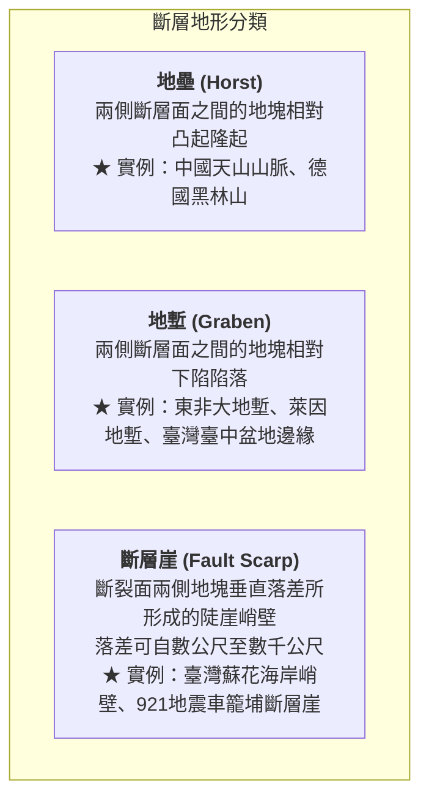

### 3. 臺灣的活動斷層與地體構造
- 臺灣本島地處歐亞板塊與菲律賓海板塊碰撞擠壓的樞紐位置，地殼活動極度活躍，全島已知分布有 **36 條活動斷層**（如課本圖 4-6）。
- **921 大地震（1999年）實例**：車籠埔斷層發生劇烈逆衝錯動，在原臺中縣霧峰鄉光復國中操場造成高達數公尺的地面抬升破裂，形成怵目驚心的斷層崖，印證斷層瞬間重塑地表的巨大力量。

---

## 四、火山作用（Volcanism）

火山作用多分布於**板塊隱沒帶（如環太平洋火環帶）**、**板塊張裂帶（如中洋脊、東非大裂谷）**及**地函熱點（如夏威夷群島）**。

### 1. 侵入式火山 vs 噴發式火山

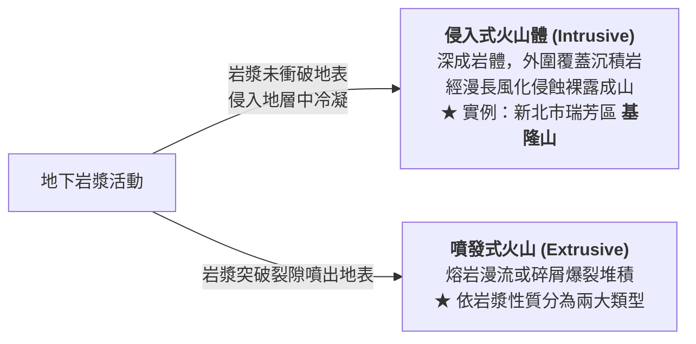

### 2. 噴發式火山兩大類型深度對比

| 噴發類型 | 寧靜式噴發 (Effusive Eruption) | 猛烈式噴發 (Explosive Eruption) |
| :--- | :--- | :--- |
| **主要岩漿性質** | **基性岩漿（玄武岩質）** | **中性至酸性岩漿（安山岩質、流紋岩質）** |
| **二氧化矽 ($SiO_2$) 含量** | **較低**（約 45% ~ 52%） | **較高**（> 55% ~ 70%） |
| **岩漿黏度與流動性** | **黏度極小、流動性極大** | **黏度極大、流動性極小（濃稠）** |
| **內部氣體散逸難易** | 氣體極易順暢逸散，**不易積聚高壓** | 濃稠岩漿封閉氣體，**極易蓄積極大高壓** |
| **噴發特徵** | 溫和溢流、少爆裂、熔岩長距離漫流 | 劇烈爆裂噴發、噴發口四周岩石爆碎拋擲 |
| **冷卻後地貌形態** | **熔岩台地、熔岩高原**、盾狀火山 | **錐狀火山（火山錐）**、複式火山、火口湖 |
| **典型代表實例** | 澎湖群島（桶盤嶼玄武岩柱狀節理）、美國哥倫比亞高原、夏威夷群島 | 印尼克里穆圖火山（火口湖）、厄瓜多通古拉瓦火山、日本富士山、臺灣大屯火山群 |

---

## 五、火山活動的危害與資源

火山活動對人類文明展現了極端強烈的「雙面性格」：

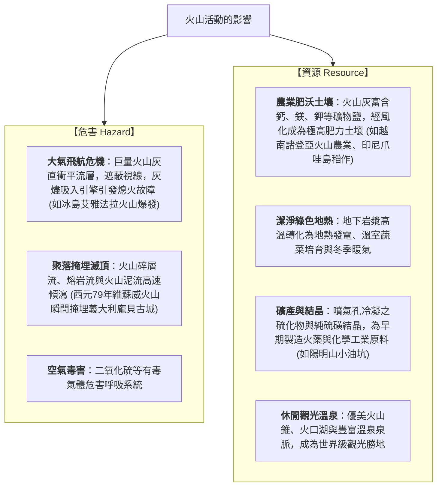

:::spoiler 點擊展開自我檢核測驗
**Q：為什麼澎湖群島呈平坦的方山台地，而七星山卻是高聳的錐狀火山？**
- **解析**：澎湖由基性玄武岩岩漿冷卻而成，二氧化矽含量低、流動性大，噴發時順著裂隙向四周漫流鋪展，冷卻後形成開闊平坦的熔岩台地；大屯火山群的七星山則由中酸性安山岩岩漿構成，流動性差、黏度高，火山碎屑物與熔岩在噴發口附近層層堆疊，形成聳拔的火山錐。
:::

---
*上一節：[01. 地形系統的概念與空間尺度](01-geomorphic-systems.md) ｜ 下一節：[03. 外營力與地形演育](03-exogenic-processes.md)*


---


# 03. 外營力與地形演育（風化、崩壞、侵蝕堆積）

:::info
**【學習重點】**
1. 掌握外營力兩大根本驅動力——**太陽輻射能**與**地球重力**的運作機制。
2. 釐清物理風化（熱脹冷縮、凍融作用）與化學風化（氧化反應、酸雨溶蝕）之環境發育條件。
3. 掌握四大崩壞類型（潛移、地滑、土石流、落石）之運動速率、含水量及判讀指標。
4. 理解差異侵蝕原理及其在臺灣海岸地貌的展現；透析八卦台地內外營力接力演育的完整歷程。
:::

---

## 一、外營力之源與基本機制

外營力主要藉由太陽輻射能驅動大氣與水循環，並在大氣圈、水圈與生物圈的共同參與下，配合地球重力牽引，不斷對地表展開**削高填低**的雕塑工程。

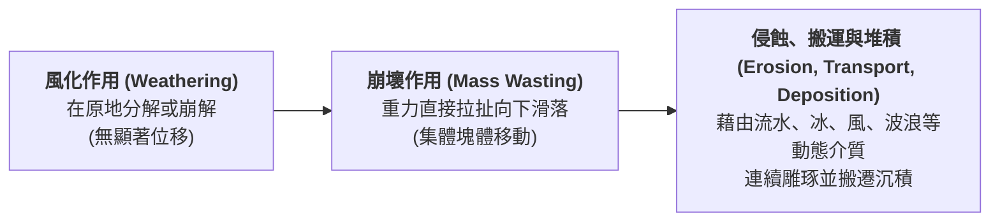

---

## 二、風化作用（Weathering）

風化作用是指地表岩石在**原地**受到大氣、水或生物影響，產生**崩解破裂**或**化學分解**的作用，**不涉及長距離搬運**。

### 1. 物理風化（崩解） vs 化學風化（分解）

| 風化類型 | 物理風化 (Mechanical / Physical Weathering) | 化學風化 (Chemical Weathering) |
| :--- | :--- | :--- |
| **本質變化** | 僅改變岩石外觀大小，**化學礦物成分不變** | 岩石礦物與水、氧、酸反應，**化學成分根本改變** |
| **主要好發環境** | **氣候乾燥、日夜溫差大**的沙漠，或**高山、高緯度寒冷區** | **高溫多雨、濕熱**的熱帶與副熱帶氣候區 |
| **核心作用機制** | 1. **熱脹冷縮**：岩石外層與內層導熱不均，受日夜溫差反覆膨脹收縮，導致表層如洋蔥般剝落（南非北開普省）。<br>2. **凍融作用（冰劈作用）**：水滲入岩石裂隙，結冰時體積膨脹約 9%，產生強大撐張力裂解巨石（加拿大格羅摩恩山碎石坡、南極洲彼德曼島）。 | 1. **氧化作用**：岩石中的鐵與水、氧結合形成氧化鐵（鐵鏽），在岩面形成如抽象畫般的「風化紋」（美國帕利亞峽谷）。<br>2. **水解與碳酸化**：水及二氧化碳形成的碳酸溶解岩石。<br>3. **酸雨腐蝕**：工業酸雨（硫酸、硝酸）腐蝕戶外大理石雕像（德國賀騰古堡雕像面目模糊）。 |

:::tip
**自然界實況：**
在真實地表環境中，物理風化與化學風化絕非孤立發生。物理風化將岩石破裂成碎屑，**大幅增加了岩石的暴露表面積**，進而倍數加速化學風化的反應速率！
:::

---

## 三、崩壞作用（Mass Wasting）

地表的土壤與岩石碎屑，主要在**地球重力**的直接牽引下，沿坡面由高處向低處移動的現象，稱為**崩壞作用**。

### 1. 崩壞發生的四大誘發條件
1. **坡度陡峭**：重力沿坡向下的下滑分力大於抗滑力。
2. **水分劇增**：豪雨使土石含水量飽和，大幅增加總重量，且水具有孔隙水壓力，大幅降低岩層間的摩擦力。
3. **地質破碎脆弱**：順向坡構造、節理發達、頁岩與砂岩互層且膠結不良。
4. **人為不當開挖**：削切坡腳、超限利用、破壞天然植被水土保持。

### 2. 四大崩壞類型矩陣剖析（對應課本圖 4-12）

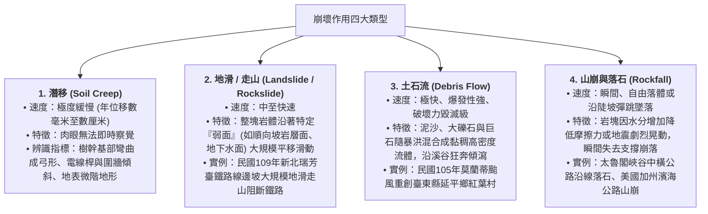

---

## 四、侵蝕、搬運與堆積作用

遭受風化與崩壞鬆動的岩屑，隨後被流水、海浪、風或冰河等外營力介質持續沖刷（侵蝕）、位移（搬運），並在動能衰減處卸載沉澱（堆積），形成動態演變的連續體。

### 1. 差異侵蝕（Differential Erosion）
地表岩層的抗蝕能力並非完全均質。火成岩、變質岩或質地堅硬的砂岩抗蝕力強；而泥岩、頁岩或斷裂破碎帶抗蝕力弱。在相同外營力作用下，兩者因消耗速度不同而形成凹凸對比鮮明的地貌。

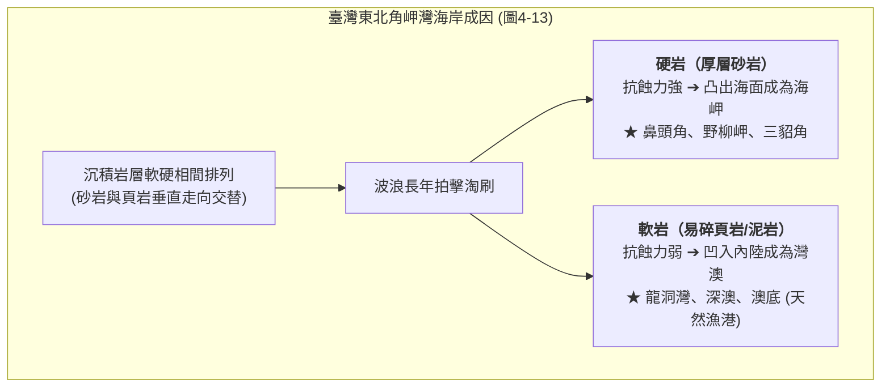

---

## 五、內外營力交互作用實例：八卦台地的誕生演育

課本圖 4-14 彰化縣與南投縣交界的**八卦台地**，是內營力與外營力在時間長河中交接棒演育的經典範例：

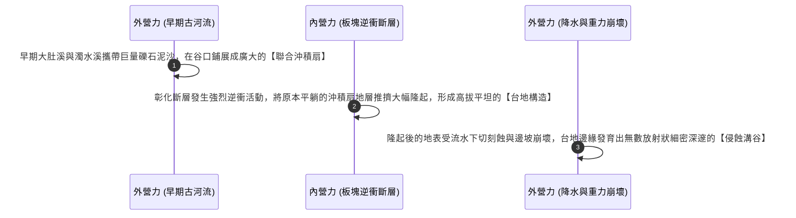

:::info
**【精髓結論】**
- **內營力是地景的建築師**：造山、抬升、斷層形成骨架。
- **外營力是地景的雕刻刀**：風化、侵蝕、切割出豐富萬千的細微輪廓。
兩者此消彼長，造就了我們今日所見的大地容顏。
:::

---
*上一節：[02. 內營力與地形演育](02-endogenic-processes.md) ｜ 下一節：[04. 探究 4-1：野柳女王頭的歲月痕跡](04-case-study-yehliu.md)*


---


# 04. 探究 4-1：野柳女王頭的歲月痕跡與蕈狀岩

:::info
**【探究情境】**
位於新北市萬里區的野柳地質公園，長年以鬼斧神工的海岸奇岩聞名遐邇，其中「女王頭」更是享譽國際的臺灣觀光地標。然而，學者與管理處長期觀測發現，女王頭的脖圍正隨著歲月持續縮水，未來正面臨無可避免的「斷頸危機」！
:::

---

## 一、蕈狀岩（Mushroom Rock）的形成機制

女王頭在地質學上屬於典型的**蕈狀岩（Mushroom Rock / Hoodoo）**。其形成過程是**地質構造、岩石抗蝕性差異與外營力作用**交織而成的傑作：

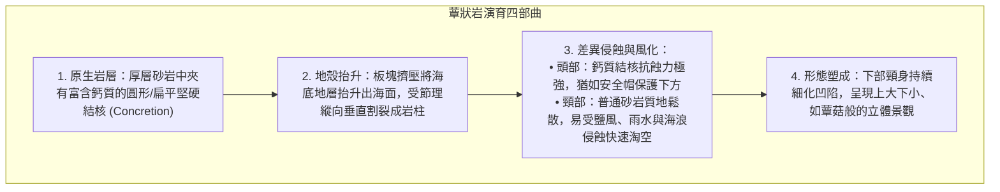

---

## 二、女王頭脖圍歷史監測數據

野柳地質公園自民國 58 年起，對女王頭的頸部進行了長期科學監測：

| 觀測年代 | 民國 58 年 (1969) | 民國 69 年 (1980) | 民國 79 年 (1990) | 民國 107 年 (2018) |
| :---: | :---: | :---: | :---: | :---: |
| **脖圍量測數值** | **256.14 cm** | 逐漸消瘦 | 持續淘細 | **僅剩 124.6 cm** |
| **外觀演變特徵** | 頸部豐滿厚實，輪廓渾厚 | 頸部線條漸顯苗條 | 凹陷日趨明顯 | 頸線極細，頭重腳輕，風化持續 |

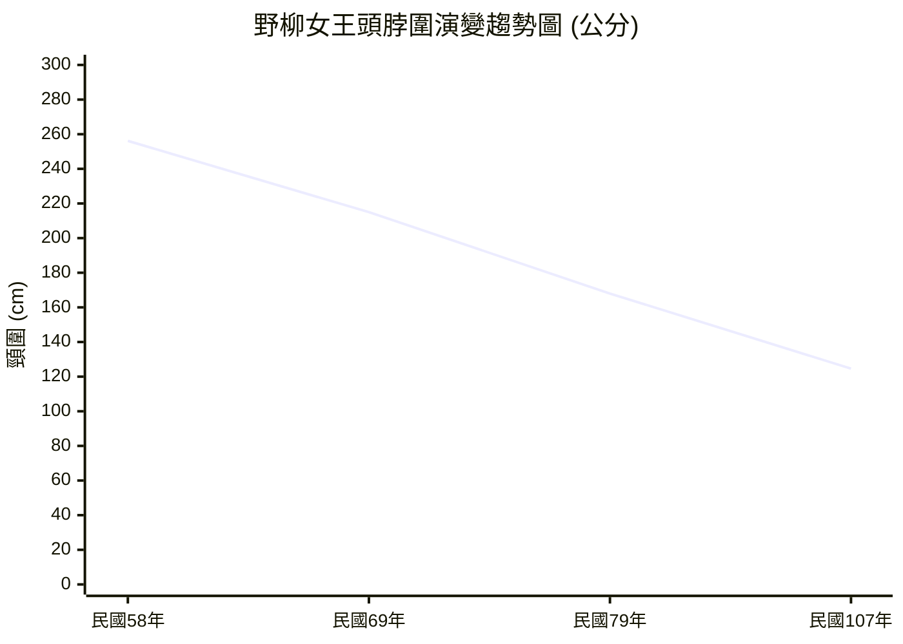

---

## 三、課本探究提問與深度解析（對應課本 P16）

### 問題 1：女王頭屬於何種尺度的地形？
:::success
**【參考解答】**
屬於**小尺度（微尺度，Micro-scale）微地形**。  
女王頭是單一奇石景觀，其長寬僅數公尺至十數公尺，是局部外營力（海風、鹽風化、風化淋溶）在特定微小空間內精細雕琢的微型地貌。
:::

### 問題 2：由照片 4-6 得知，女王頭外形變化最大的部位為何處？
:::success
**【參考解答】**
**頸部（脖圍部位）**。  
頸圍由民國 58 年的 256.14 公分，銳減至民國 107 年的 124.6 公分，萎縮超過一半，頸部受淘空程度最為劇烈，承重脆弱度日益升高。
:::

### 問題 3：女王頭屬於蕈狀岩地形。分析通常造成蕈狀岩地形的主要原因為何？
:::success
**【參考解答】**
核心成因為**差異風化（Differential Weathering）與差異侵蝕（Differential Erosion）**：
1. **頂部（頭部）**：為富含碳酸鈣質的堅硬結核，膠結緻密，抵抗風雨侵蝕與鹽風化能力強。
2. **下部（頸部）**：為一般沉積砂岩，缺乏高鈣膠結物，質地較軟且節理裂隙發達，在大氣乾濕交替、日照熱脹冷縮及海水飛沫鹽分結晶撐裂作用下，剝落速度遠快於頂部，導致頸部不斷被掏空細化。
:::

### 問題 4：估計在未來 10～15 年間女王頭頸部恐將斷裂。我們應該利用現代奈米科技塗料人為加固延長壽命，還是順應自然任其斷裂？
:::warning
**【核心思辨：地質保育 vs 自然演育】**
本題為開放式人地價值思辨題，兩種立場皆有其深刻論述：

- **支持人為科技補強（文化景觀與經濟觀點）**：
  - 女王頭已是臺灣國際意象代表與幾代人的集體歷史文化記憶，具備無可替代的品牌價值。
  - 野柳每年吸引數百萬國際與在地觀光客，維持女王頭可保障在地觀光產業發展與經濟生計。
  - 科技保護（如奈米防水透氣固化劑）是現代文化與地質遺產維護的合理手段。

- **支持順應自然法則（地質演育與生態倫理觀點）**：
  - 地貌本是動態系統，誕生、成熟、凋零與瓦解是自然營力演育的必然規律。強行人工固化，反而失去地質活教材的科學真諦。
  - 野柳隨時都在孕育新的奇石，例如民國 99 年因崩落新形成、被遊客票選命名為「**俏皮公主**」的蕈狀岩，正是女王頭最佳的天然接班人。
  - 自然的消失能成為最震撼人心的環境教育題材，教育人類學會尊重自然演化、珍惜當下地景。
:::

---
*上一節：[03. 外營力與地形演育](03-exogenic-processes.md) ｜ 下一節：[05. 河流作用與地形](05-fluvial-landforms.md)*


---


# 05. 河流作用與地形（上中下游、侵蝕搬運堆積、河階曲流）

:::info
**【學習重點】**
1. 掌握陸地流水系統與河川侵蝕的三大方向（向源侵蝕、下蝕、側蝕）及侵蝕基準面概念。
2. 剖析河流上游侵蝕地形（峽谷、瀑布）的成因機制與等高線特徵。
3. 精熟山麓沖積扇（扇頂、扇央、扇端湧泉帶）沉積物粒徑、地下水文與土地利用對比。
4. 深度解析曲流凹岸（基蝕坡）與凸岸（滑走坡）的水力學差異、牛軛湖演育及河階地質成因。
:::

---

## 一、河流作用與水文動力

流水是地表分布最廣、雕塑威力最強大的外營力介質。降水降落地表後，扣除蒸發與下滲，匯聚成地表逕流奔騰入海。

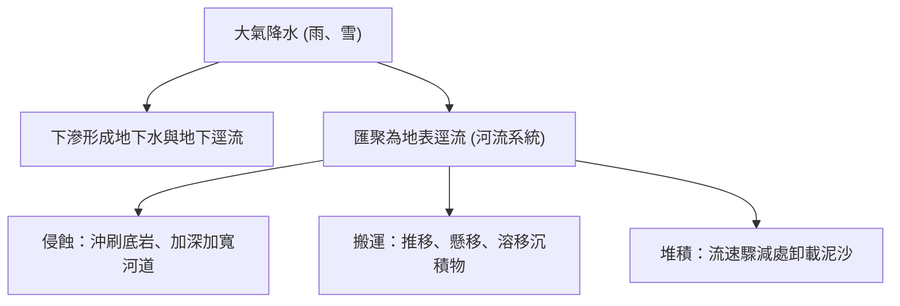

### 1. 決定河流流速與侵蝕力的關鍵要素
- **地勢落差（坡度）**：坡度愈陡，水流重力分力愈大，流速愈迅猛。
- **河流流量**：流量愈充沛，動能愈大。
- **河道斷面特徵**：河道狹窄深邃時，水流集中，流速顯著提升。

### 2. 河川侵蝕的三大方向（對應課本圖 4-16）

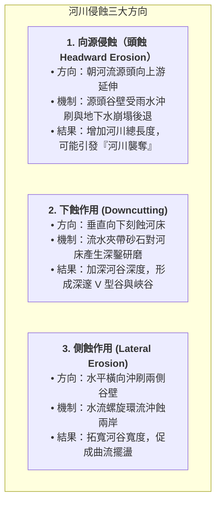

### 3. 侵蝕基準面（Base Level）
河流向下侵蝕具有不可跨越的最低物理極限，稱為**侵蝕基準面**：
- **終極侵蝕基準面**：即**海平面**。陸地河流最終無法下切至海平面以下。
- **暫時侵蝕基準面**：河流中途注入的湖泊、水庫水面，或支流匯入主流的交匯口。
- **基準面變動引發回春作用**：若地殼抬升或海平面相對下降，相當於侵蝕基準面相對降低，河流下蝕潛能瞬間復甦，重新劇烈下切，孕育河階與峽谷。

---

## 二、河流侵蝕地形

主要發育於**河流上游**高山地區，此區落差大、流速急，以**下蝕與向源侵蝕**為主導。

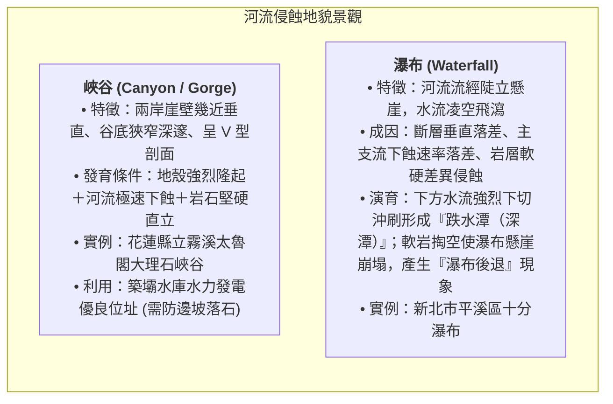

---

## 三、河流堆積地形

主要發育於**河流出山口、中下游平原與河口**，此區坡度變緩、流幅變寬，水流動能減弱，泥沙紛紛沉澱。

### 1. 山麓沖積扇（Alluvial Fan）深入剖析
河流自崇山峻嶺奔出谷口進入開闊平原時，流速驟減，大量砂礫在谷口向外展開沉積成半圓形扇狀地貌（圖 4-19）。

| 沖積扇分區 | 沉積物顆粒 | 透水性與地表水 | 農業與土地利用形態 | 災害風險 |
| :--- | :--- | :--- | :--- | :--- |
| **扇頂 (Apex)**<br>(近谷口) | 巨石、粗礫石為主 | 透水性極佳，地表水迅速下滲，地下水位極深 | 水源匱乏，早期開發晚；以果園、旱作或林地為主 | 出山口首當其衝，暴洪與**土石流**高危險區 |
| **扇央 (Fan Body)**<br>(扇面中部) | 砂礫與中粒粗砂 | 透水性良好，乾旱期地表常形成季節性乾溪 | 旱田、茶園、果樹；聚落零星分布 | 洪水漫流改道侵蝕 |
| **扇端 (Toe)**<br>(扇面外緣) | 細砂、黏土與粉砂 | **地下水遇阻截，在此呈帶狀自地表湧出，形成「湧泉帶」** | **水源極度充沛、灌溉便利，土地開墾早，水稻田廣布，聚落密集**（如屏東縣萬巒鄉**五溝水**） | 地勢低平易有內澇積水 |

### 2. 氾濫平原與三角洲

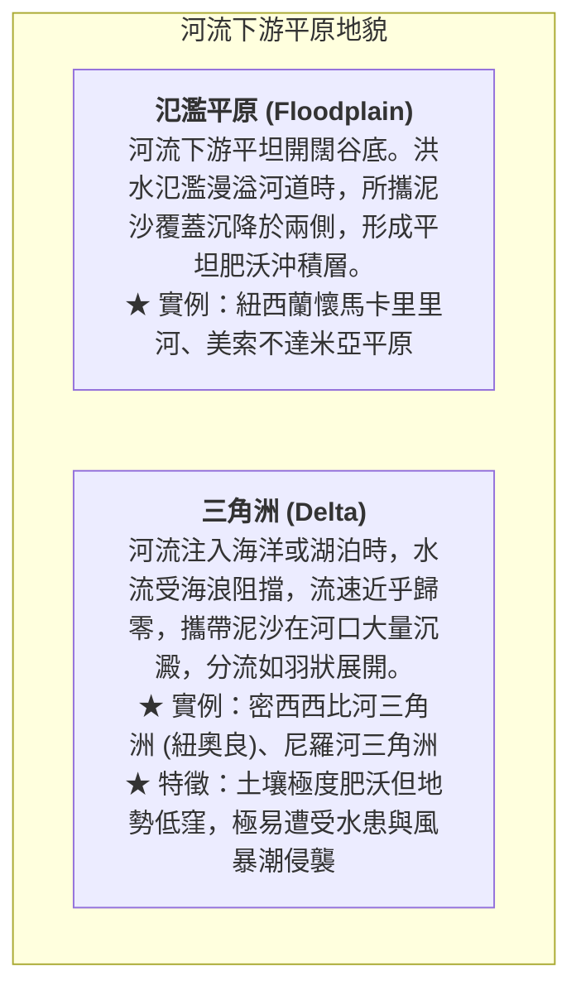

---

## 四、侵蝕與堆積共同作用地形：曲流與河階

河流在中下游或平緩盆地，侵蝕與堆積往往在同一河段左右兩岸同步上演。

### 1. 曲流（Meander）與牛軛湖（Oxbow Lake）演育
當平原河流因流路受阻或河幅擺盪，會發展出迂迴蜿蜒的曲流（圖 4-22）：


#### 凹岸 vs 凸岸 水力學特性對比

| 比較項目 | 凹岸（基蝕坡 Cut Bank） | 凸岸（滑走坡 Point Bar） |
| :--- | :--- | :--- |
| **水流衝擊情況** | 主流線直衝外側，水流湍急 | 位於流線內側，水流減緩滯留 |
| **主要營力作用** | **侵蝕作用（強烈側蝕淘刷）** | **堆積作用（泥沙平鋪淤積）** |
| **橫斷面地形** | **谷壁陡峭狹窄，水深極深** | **坡度平緩，形成水淺之沙灘岸** |
| **河岸演變趨勢** | 河岸持續向陸地後退 | 陸地持續向河道中央延伸擴張 |
| **人類土地利用** | 水深適合停泊，常設為**渡口、深水港碼頭** | 地勢平坦肥沃，適宜**農耕開墾、水田種植** |
| **潛在災害威脅** | 地基淘空、護岸倒塌（如臺東知本溪災例） | 枯水期風吹揚塵，洪水期漫淹 |

### 2. 河階地形（River Terrace）
- **成因機制**：原本在寬廣谷底發育的氾濫平原或舊河床，因為**地殼間歇性隆起**或**侵蝕基準面下降**，驅使河川重新強力下蝕，將原先平坦的舊河床切割並相對抬升於高處，形成多層階梯狀地貌。
- **構造部位**：
  - **河階面**：平坦的舊河床面，地勢開闊平整。
  - **河階崖**：河流下蝕切穿地層留下的陡峭斜坡。
- **人地關係實例**：**桃園市大溪區**的大漢溪流域分布著極具代表性的多層河階。河階面平坦近水，且高出目前河道數十公尺，**不易遭受暴洪淹沒**，成為先民建構聚落、開闢大溪老街與耕地的絕佳環境！

---
*上一節：[04. 探究 4-1：野柳女王頭](04-case-study-yehliu.md) ｜ 下一節：[06. 岩溶作用與喀斯特地形](06-karst-landforms.md)*


---


# 06. 岩溶作用與喀斯特地形（地表溶蝕、地下洞穴、睡美人洞）

:::info
**【學習重點】**
1. 掌握岩溶作用（碳酸鈣溶解與重沉澱）的化學反應機制與三大地質氣候發育條件。
2. 熟練掌握地表喀斯特地貌的演育演進序列（滲穴 $\rightarrow$ 窪盆 $\rightarrow$ 溶蝕盆地 $\rightarrow$ 錐丘 $\rightarrow$ 殘丘）。
3. 剖析地下石灰岩洞穴構造（伏流、鐘乳石、石筍、石柱）的沉積歷程。
4. 深度研讀泰國「睡美人洞」救援事件，剖析喀斯特洞穴水文特徵與野外地質探險風險。
:::

---

## 一、岩溶作用的化學機制與發育條件

在石灰岩、石膏或岩鹽等可溶性岩層廣布的地區，水與岩石發生可逆的化學溶解與沉澱反應，塑造出奇偉瑰麗的地貌，統稱為**岩溶地形**或**喀斯特地形（Karst Topography）**（得名於斯洛維尼亞喀斯特高原）。

### 1. 化學反應平衡式
$$\text{溶解溶蝕反應（侵蝕）：} \quad \mathrm{CaCO_3} \ (\text{固體石灰岩}) + \mathrm{H_2O} + \mathrm{CO_2} \longrightarrow \mathrm{Ca(HCO_3)_2} \ (\text{可溶性碳酸氫鈣水溶液})$$

$$\text{沉澱析出反應（堆積）：} \quad \mathrm{Ca(HCO_3)_2} \longrightarrow \mathrm{CaCO_3 \downarrow} \ (\text{鐘乳石沉澱結晶}) + \mathrm{H_2O} + \mathrm{CO_2 \uparrow}$$

- **溶蝕階段**：雨水在降落過程中吸收大氣二氧化碳，或滲入富含有機酸的土壤層，形成弱酸性水溶液。當其流經石灰岩裂隙時，將難溶的碳酸鈣溶解為可溶的碳酸氫鈣帶走。
- **堆積階段**：當含有碳酸氫鈣的水溶液滲入通風開闊的地下溶洞時，因壓力驟降或溫度升高，水分蒸發且二氧化碳逸出，碳酸鈣重新析出結晶。

### 2. 喀斯特地形發育的三大黃金條件
1. **可溶性厚層岩層**：地層中含有質地純厚、巨厚層的石灰岩（主要成分 $\mathrm{CaCO_3}$）。
2. **高溫多雨的氣候環境**：充沛的降水提供溶蝕動力；高溫促使植物繁茂，土壤呼吸釋放高濃度 $\mathrm{CO_2}$，大幅增強地下水的酸蝕能力。
3. **岩層節理裂隙發達且地下水位深**：地表岩石必須具備充足垂直節理，便於地表水迅速向下滲透刻蝕。

---

## 二、地表岩溶地形演育序列（由幼年至老年）

隨地質時間推移，地表石灰岩層經歷連續的溶蝕退化，展現出階梯式的地貌演育循環（圖 4-25、圖 4-26）：

```mermaid
flowchart TD
    A["<b>1. 滲穴 / 落水洞 (Sinkhole / Doline)</b><br>酸水沿垂直節理裂隙溶蝕或洞頂崩塌，形成圓形漏斗狀凹坑<br>★ 實例：澳洲甘比爾山、重慶奉節小寨天坑 (天下第一坑，寬深逾500公尺)"]
    A --> B["<b>2. 窪盆 (Uvala)</b><br>相鄰的數個滲穴隨著溶蝕持續擴大、邊壁塌陷，互相連通融合成面積較大的封閉凹地<br>★ 實例：中國廣西壯族自治區窪盆"]
    B --> C["<b>3. 溶蝕盆地 (Polje / 坡立谷)</b><br>大規模溶蝕導致底層平坦、面積達數十至數百平方公里的寬廣盆地，底部多富集不透水紅土沉積物<br>★ 實例：中國貴州省興義市『壩子』（農業聚落集聚核心）"]
    C --> D["<b>4. 錐丘 / 峰林 (Cone Karst / Peak Forest)</b><br>溶蝕盆地四周未被完全蝕穿、殘留高聳成簇的陡峭圓錐狀岩峰群<br>★ 實例：廣西桂林山水、貴州萬峰林"]
    D --> E["<b>5. 殘丘 / 峰叢 (Tower Karst / Mogote)</b><br>老年期岩層近乎被夷平殆盡，平坦平原上僅散布零星孤立、坡緩低矮的岩石殘丘<br>★ 實例：菲律賓保和島（莫好島）巧克力山"]
```

:::warning
**喀斯特地區的土地利用限制：**
石灰岩區風化土層極為淺薄，且地表水極易沿裂隙快速漏失，呈現**「地表水貴如油，地下水滾滾流」**的乾旱窘境。農耕與聚落主要高度依賴地勢平坦、具保水紅土層的溶蝕盆地（西南地區俗稱**壩子**）。
:::

---

## 三、地下洞穴與沉積地形

當地下水長時間在石灰岩地層內部漫流溶蝕，會淘空形成錯綜複雜的地下宮殿——**石灰岩洞穴（溶洞）**。

### 1. 伏流（Underground River）
地表河水流經喀斯特裂隙或滲穴時完全向下滲漏，在地底暗黑管道中奔流，稱為**伏流**。中美洲馬雅文明在石灰岩高原上生活，即高度仰賴天然天井與伏流水源。

### 2. 地下沉積景觀（滴石地貌，圖 4-27）

```mermaid
flowchart LR
    Drop["含碳酸氫鈣水滴從洞頂滲出"] -->|水分蒸發、釋放CO2<br>碳酸鈣自洞頂向下結晶| S1["<b>鐘乳石 (Stalactite)</b><br>如冰錐般自洞穴天花板懸垂向下生長"]
    Drop -->|水滴滴落地面飛濺<br>碳酸鈣自地面向上凝結| S2["<b>石筍 (Stalagmite)</b><br>下粗上尖、如竹筍般自洞底向上聳立"]
    S1 & S2 -->|歲月累積、上下相接貫通| S3["<b>石柱 (Column)</b><br>天花板與地面相連成堅固石柱"]
```

- **世界名勝**：斯洛維尼亞**波斯托伊納溶洞（Postojna Cave）**、日本沖繩**玉泉洞**。

---

## 四、專題探討：泰國睡美人洞 18 天大救援的地質水文解析

課本 P28 專欄「來報報」詳述了 2018 年震驚全球的泰國清萊府**睡美人洞（Tham Luang Nang Non）**救援奇蹟：

```mermaid
sequenceDiagram
    autonumber
    actor Team as 少年足球隊 (13人)
    participant Cave as 睡美人石灰岩洞穴
    participant Hydro as 地表季風降雨水文
    actor Rescuers as 跨國搜救與海豹部隊

    Team->>Cave: 進入泰國第四大石灰岩洞穴探險慶生 (深入地底數公里)
    Hydro->>Cave: 6月底西南季風引發暴雨，地表雨水透過裂隙與滲穴狂灌入洞
    Cave->>Cave: 洞內低窪段完全滅頂形成「水浸洞穴」，退路遭暴漲地下伏流封死
    Team->>Cave: 退無可退，受困於洞內高處乾燥高台長達10天未進食
    Rescuers->>Hydro: 調集高功率幫浦日夜強抽數百萬噸積水以降低水位
    Rescuers->>Team: 洞潛專家深入狹窄水下通道尋獲全員，採取「雙潛伴一人」護送
    Team->>Rescuers: 全員戴全罩氧氣面罩、穿潛水防寒衣，成功全數平安救出
```

### 【地理核心思維】地質環境與災害意識
1. **喀斯特水文之不可預測性**：石灰岩洞穴並非封閉水管，而是與廣大地表裂隙相通的水系匯聚管道。地表一下大雨，地下水位會在數小時內暴漲數公尺。
2. **探險風險評估**：地貌環境的利用（如觀光探險）必須嚴格順應氣候節奏，雨季期間絕不可貿然進入地下溶洞系統！

---
*上一節：[05. 河流作用與地形](05-fluvial-landforms.md) ｜ 下一節：[07. 冰河作用與地形](07-glacial-landforms.md)*


---


# 07. 冰河作用與地形（冰蝕、冰積、冰融流水）

:::info
**【學習重點】**
1. 掌握冰河形成的物理條件，理解「磨蝕」與「拔蝕」兩大冰蝕動力學機制。
2. 系統性辨識高山冰蝕地貌（冰斗、刃嶺、角峰、U型谷、槽湖、峽灣）之景觀特徵與等高線判別。
3. 掌握「直接冰積物（冰磧）」與「冰融流水沉積物（外洗沉積）」在粒徑分選與層理構造上的本質差異。
4. 解構歐洲第四紀大陸冰河由北往南的空間帶譜（冰蝕區 $\rightarrow$ 冰磧區 $\rightarrow$ 外洗平原 $\rightarrow$ 黃土帶）。
:::

---

## 一、冰河的誕生與運動機制

冰河被譽為地球表面「最壯麗的冰之巨龍」。目前全球約有 **10% 的陸地面積**被冰河所覆蓋（主要集中於南極大陸、格陵蘭島及全球極高山地區）。

### 1. 冰河形成條件
在終年酷寒的高緯度或雪線以上高山，年降雪量大於融雪量：
$$\text{大氣降雪} \xrightarrow{\text{層層積壓}} \text{粒雪 (Firn)} \xrightarrow{\text{空氣擠出、重結晶}} \text{緻密冰川冰 (Glacial Ice)}$$
當冰層累積厚度達數十公尺後，在地球**重力牽引**與自重塑性流動壓力下，開始順坡向低處緩慢滑移，正式誕生為**冰河（Glacier）**。

### 2. 冰蝕作用的兩大動力機制（對應課本圖 4-30）

```mermaid
flowchart LR
    Ice["冰河移動動態"]
    Ice --> Abr["<b>1. 磨蝕作用 (Abrasion)</b><br>• 機制：冰河底部鑲嵌的堅硬岩塊，如砂紙般對底岩與谷壁進行強烈刮磨刻劃<br>• 景觀：底岩磨光面、冰擦痕 (Striations)、岩粉"]
    Ice --> Pluck["<b>2. 拔蝕作用 (Plucking)</b><br>• 機制：冰河底部融水滲入底岩裂隙凍結膨脹，冰河前行時硬生將破裂岩塊連根拔起凍結帶走<br>• 景觀：鋸齒狀粗糙拔蝕崖面"]
```

---

## 二、冰河侵蝕地形（高山冰河景觀）

冰河質量龐大，具有遠勝流水下切的拓寬與深鑿能力，將昔日狹窄的 V 型溪谷徹底改造成雄奇的地景（圖 4-31、圖 4-32）：

```mermaid
graph TD
    Cirque["<b>冰斗 (Cirque)</b><br>高山冰河源頭雪線附近，經拔蝕與凍融形成之半圓形、圍椅狀陡壁凹坑<br>★ 實例：阿拉斯加冰斗、雪山一號圈谷"]
    Cirque -->|積水成湖| Tarn["<b>冰斗湖 (Tarn)</b><br>冰河消融後冰斗底部低窪積水之高山湖泊"]
    Cirque -->|兩側相背侵蝕| Arete["<b>刃嶺 (Arête)</b><br>相鄰兩座冰斗或冰蝕谷夾峙出的陡薄刀刃狀山脊"]
    Arete -->|三座以上冰斗匯聚| Horn["<b>角峰 (Horn)</b><br>數座冰斗朝中心逆向劇烈侵蝕，形成的尖銳金字塔形角錐山峰<br>★ 實例：瑞士阿爾卑斯山馬特洪峰 (且維諾峰)"]
    
    Valley["<b>U型谷 (冰蝕谷 U-shaped Valley)</b><br>高山冰河主幹刻鑿出谷壁垂直陡峭、谷底開闊平坦之 U 字型槽谷<br>★ 功能：谷底平坦，為阿爾卑斯山南北兩側往來的重要天然交通孔道"]
    Valley -->|谷底凹凸積水| TroughLake["<b>槽湖 (Trough Lake / 串珠湖)</b><br>U型谷底受拔蝕深淺不均，冰退後積水呈長條狀湖泊<br>★ 實例：加拿大班夫國家公園沛托湖 (Peyto Lake)"]
    Valley -->|延伸入海海水倒灌| Fjord["<b>峽灣 (Fjord)</b><br>延伸至海岸的冰河谷，冰融海升後海水強烈入侵形成深邃峽谷<br>★ 特徵：兩岸峭壁千仞、谷深水深浪平，為極佳避風良港<br>★ 實例：挪威蓋朗厄爾峽灣 (維京航海文化搖籃)、紐西蘭米佛峽灣"]
```

---

## 三、冰河堆積地形：冰磧 vs 外洗沉積

冰河搬運物質的能力極強，但其堆積機制依「是否經過流水淘選」可截然劃分為兩大家族：

```mermaid
flowchart TD
    subgraph Direct["【直接冰積物：冰磧 (Till / Moraine)】"]
        D1["<b>冰磧特性</b>：<br>• 由冰河本體融化直接原地卸載<br>• <b>大小混雜極度懸殊</b> (巨石與黏土並存)<br>• <b>完全缺乏淘選度、毫無層理構造</b><br>• 礫石表面帶有清晰冰擦痕"]
        D2["<b>端磧 (Terminal Moraine)</b>：<br>冰河前緣長年消融停滯處堆積成的弧形壟狀小丘 (格陵蘭)"]
        D3["<b>冰磧平原 (Till Plain)</b>：<br>冰磧鋪展之波狀起伏平原，窪地多積水沼澤，整地拓墾極為困難"]
    end

    subgraph Fluvial["【冰融流水沉積物：外洗沉積 (Outwash)】"]
        F1["<b>外洗特性</b>：<br>• 冰層消融之高壓冰雪融水，經由冰底隧道向外噴湧奔流搬運<br>• <b>顆粒受流水良好淘選，粒徑均勻，具備清晰沉積層理</b>"]
        F2["<b>外洗扇 (Outwash Fan)</b>：<br>冰融流水切穿端磧，在冰河前緣沉積之扇狀平原 (阿拉斯加)"]
        F3["<b>外洗平原 (Outwash Plain)</b>：<br>寬廣平坦的外洗砂礫平原"]
    end
```

---

## 四、宏觀空間帶譜：歐洲第四紀大陸冰河分布（圖 4-34）

距今約一萬多年前的第四紀冰河時期，巨大的大陸冰層覆蓋了北歐全境。隨著氣候回暖冰河退縮，在歐洲大陸自北向南留下了極具規律的**地貌與土壤過渡帶**：

```mermaid
flowchart LR
    North["【最北端：冰蝕中心】<br>斯堪地那維亞半島<br>• 冰蝕平原、峽灣、千湖之國<br>• 土壤極度淺薄貧瘠"] --> Mid1["【中北部：冰磧區】<br>波羅的海沿岸、波德平原北段<br>• 端磧壟、冰磧平原<br>• 沼澤縱橫，耕作難度高"]
    Mid1 --> Mid2["【中部：外洗平原】<br>德國、波蘭北部平原<br>• 砂礫外洗平原<br>• 透水性高，林業廣布"]
    Mid2 --> South["【南緣：黃土台地】<br>德國中部、波蘭南部台地<br>• 冰緣乾燥強風吹揚外洗細粉堆積<br>• <b>土壤深厚肥沃，歐洲核心精華農業帶</b>"]
```

:::spoiler 點擊展開自我檢核測驗
**Q：如何從沉積物樣本一眼分辨它是「冰磧物」還是「河流沉積物」？**
- **解析**：
  1. **粒徑均勻度（淘選度）**：冰磧物顆粒大小極度混雜（從數公尺巨石到細泥均有），沒有淘選；河流沉積物經過水流分選，粒徑相當均勻。
  2. **層理有無**：冰磧物內部雜亂無章，完全沒有分層層理；河流沉積物具有明顯的水流沉積層理構造。
  3. **顆粒磨圓度**：冰磧礫石多呈稜角狀或具磨光扁平面，帶有刮痕；河流礫石經滾動多呈光滑圓潤的鵝卵石。
:::

---
*上一節：[06. 岩溶作用與喀斯特地形](06-karst-landforms.md) ｜ 下一節：[08. 探究 4-2：屏東平原水利改道與沖積扇](08-case-study-pingtung.md)*


---


# 08. 探究 4-2：屏東平原水利改道與沖積扇演育

:::info
**【探究情境】**
位於南臺灣的屏東平原，東側緊依高聳的中央山脈，兩者交界處橫亙著構造活躍的「潮州斷層」。源自高山的隘寮溪奔流出谷，在平原上鋪展出壯闊的山麓沖積扇。日治時期一項重大的防洪導流工程，如何牽動了全流域的泥沙命脈，甚至引發數十公里外海岸線的後退劇變？
:::

---

## 一、地理背景與空間構造格局（對應課本圖 4-35）

```mermaid
flowchart TD
    subgraph Structure["屏東平原地體構造格局"]
        CM["中央山脈 (高峻變質岩山地)<br>強烈板塊抬升，地形陡峭落差大"] -->|地質邊界：潮州斷層| Fault["<b>潮州斷層帶</b><br>東側地塊持續抬升，出山口發育階地群"]
        Fault --> Fan["<b>隘寮溪大型山麓沖積扇</b><br>谷口堆積大量礫石泥沙，早期分流如網"]
        Fan -->|早年天然分流 A| KPR["向西注入高屏溪主流"]
        Fan -->|早年天然分流 B| TKR["向西南注入東港溪主流"]
    end
```

### 1. 歷史水患與昭和 13 年（1938）改道大工程
- **早年危機**：隘寮溪為典型的荒溪型暴烈河川，每逢夏秋颱風豪雨，巨量山洪挾帶砂石在沖積扇頂任意漫流氾濫，造成下游屏東平原村落與農田嚴重水患。
- **治理策略**：臺灣總督府於日治昭和 13 年（1938年），自扇頂修築一道堅固的**「隘寮溪南岸長堤」**，強行阻斷隘寮溪向西南流向東港溪的天然分流，全面導引溪水轉向西北奔流，強迫其匯入高屏溪上游支流荖濃溪，成為荖濃溪的永久支流。

---

## 二、水利工程引發的地形系統連鎖反饋

```mermaid
sequenceDiagram
    autonumber
    actor Gov as 人類活動 (1938年修築南岸長堤)
    participant Ailiao as 隘寮溪扇頂水文
    participant Donggang as 東港溪下游河道
    participant Coast as 東港溪出海口海岸

    Gov->>Ailiao: 築堤全面防堵西南向分流
    Ailiao->>Donggang: 東港溪完全失去隘寮溪豐水期水源挹注
    Donggang->>Donggang: 東港溪主流流量驟減，河流搬運能力大幅衰退
    Donggang->>Coast: 輸往出海口的泥沙沉積量呈現斷崖式短缺
    Coast->>Coast: 波浪侵蝕動能 > 泥沙補注量，海岸線嚴重後退掏空！
```

---

## 三、課本探究提問與深度解析（對應課本 P36）

### 問題 1：潮州斷層以東山谷出口處的階地形成，應與斷層東側的地塊出現何種作用有關？
- **作答選擇**：☑ **抬升**　☐ 沉降
:::success
**【深度解析】**
斷層東側的中央山脈屬於板塊造山帶，受到菲律賓海板塊向西擠壓，**地塊處於持續構造抬升狀態**。地塊抬升導致河流的侵蝕基準面相對下降，激發河流下蝕動能，切穿早期的古沖積扇面，在谷口兩側留下一層層高拔平坦的「階地」景觀。
:::

### 問題 2：在河流流出山谷之前，中央山脈地形區內發生的哪些外營力作用有助於供應土石泥沙形成沖積扇？
- **作答選擇**：
  - ☑ **風化作用**
  - ☑ **崩壞作用**
  - ☑ **侵蝕作用**
  - ☑ **搬運作用**
  - ☐ 堆積作用
:::success
**【深度解析】**
- **風化**：高山溫差與充沛雨水促使岩石在原地崩解碎裂。
- **崩壞**：陡坡上破碎岩石在豪雨重力下拉動，引發山崩與土石流，提供巨量鬆散碎屑。
- **侵蝕**：暴雨地表逕流強烈沖刷淘削河床與兩側谷壁。
- **搬運**：湍急的湍流將崩落的巨石、泥沙高速向下游席捲搬移。
- *（註：堆積作用發生在流出谷口之後的平原區，山區內部主要為物料供應與搬離端，非堆積端）。*
:::

### 問題 3：隘寮溪堤防修築和東港溪口海岸後退的關聯，主要是圖 4-1 地形系統中哪個面向的改變所造成？
- **作答選擇**：
  - ☑ **人為活動改變外營力，進而影響形貌變化**
  - ☐ 人為活動改變內營力，進而影響形貌變化
:::success
**【核心思維結論】**
人類興修堤防、水庫等水利工程屬於**人為活動**；堤防截斷天然分流，根本改變了**地表流水（外營力介質）的水量分布與泥沙搬運物質流**；下游缺乏沙源，打破了河口「波浪侵蝕 vs 泥沙堆積」的原有動態平衡，最終導致出海口形貌退縮。這正是**「人類活動干預外營力與物質流 $\rightarrow$ 重塑地表形貌」**的經典地理實證！
:::

---
*上一節：[07. 冰河作用與地形](07-glacial-landforms.md) ｜ 下一節：[09. 風力作用與風成地形](09-aeolian-landforms.md)*


---


# 09. 風力作用與風成地形（風蝕、風積、黃土高原）

:::info
**【學習重點】**
1. 掌握風力作用（吹蝕、磨蝕、風積）的物理機制及其在乾燥區與濱海帶的發育條件。
2. 釐清風蝕地形演育序列（底岩 $\rightarrow$ 礫漠 $\rightarrow$ 岩漠）。
3. 掌握三大主要沙丘類型（新月丘、橫沙丘、縱沙丘）的外觀特徵與主導風向判定技巧。
4. 剖析風積黃土的成因、土壤肥力特性與中國黃土高原水土流失的人地關係。
:::

---

## 一、風力作用的營力機制

風是大氣流動產生的動能。在**氣候乾旱、植被稀疏、物理風化旺盛**的乾燥荒漠區，或是**沙源豐富的河流乾枯河床與開闊海灘**，風力成為地表最強悍的地貌雕塑師。

```mermaid
flowchart TD
    Wind["風力動能"]
    Wind --> Ero["<b>風蝕作用 (Wind Erosion)</b><br>• 吹蝕作用：強風將乾燥鬆散的細砂與粉塵捲揚吹離<br>• 磨蝕作用：強風夾帶飛砂高速撞擊、刮磨岩面 (如天然噴砂機)"]
    Wind --> Depo["<b>風積作用 (Wind Deposition)</b><br>• 當風速減緩或遭遇地表起伏、灌叢阻擋時，所懸浮搬運的砂粒大量沉降沉澱<br>• 堆積物特徵：<b>顆粒細小、粒徑高度均勻 (淘選極佳)、無顯著層理</b>"]
```

---

## 二、風蝕地形：礫漠與岩漠的演育

乾燥地區裸露的岩石受強烈熱脹冷縮崩解碎裂後，在強風持續吹蝕下展現階梯式地貌演進（對應課本圖 4-36）：

```mermaid
flowchart LR
    A["原始地表：基岩風化碎裂成大小混雜的礫石與細砂"] -->|強烈吹蝕：細砂粉塵全被強風捲走| B["<b>礫漠 (Reg / 戈壁)</b><br>地表覆蓋緊密排列的粗大礫石層 (荒漠漆面)<br>★ 實例：澳大利亞內陸礫漠、蒙古戈壁"]
    B -->|礫石繼續風化成粉碎屑再被風吹空| C["<b>岩漠 (Hamada)</b><br>地表無砂無礫，完全裸露光禿禿的堅硬底岩基盤<br>★ 實例：美國亞利桑那州荒漠、撒哈拉哈馬達岩漠"]
```

- **其他微型風蝕地貌**：
  - **風稜石（Ventifact）**：礫石受固定方向飛砂長期單向磨削，形成具平整切面與稜角的奇石（如臺灣富貴角、白沙灣海岸）。
  - **風蝕蕈狀岩 / 雅丹地貌（Yardang）**：基岩受下層低處高密度飛砂磨蝕掏空。

---

## 三、風積地形：沙丘形態與風向判定

在沙源持續供應處，風力堆積成各類形態多變的小丘，稱為**沙丘（Sand Dune）**。沙丘廣布的大沙漠稱為**沙質沙漠（Erg）**，例如中國新疆的塔克拉瑪干沙漠（維吾爾語意為「進得去出不來 / 沙漠下是我們的故土」）。

### 1. 三大核心沙丘類型判定技巧（對應課本圖 4-37）

```mermaid
graph TD
    subgraph Dunes["三大沙丘類型與風向判定"]
        B["<b>1. 新月丘 (Barchan)</b><br>• 條件：<b>單一恆定風向</b>、沙源供應較有限<br>• 外觀：呈完美新月形或眉月形弧度<br>• 坡度：<b>迎風坡平緩 (約10°~15°)，背風坡陡峭 (滑落面約32°~34°)</b><br>• 風向判別：<b>兩翼尖端向前伸展的方向，即為盛行風的前進方向！</b>"]
        T["<b>2. 橫沙丘 (Transverse Dune)</b><br>• 條件：<b>單一恆定風向</b>、沙源極度充沛廣大<br>• 外觀：如海浪般的長條波狀沙脊連綿起伏<br>• 風向判別：<b>沙脊的走向與盛行風向『垂直交會』！</b>"]
        L["<b>3. 縱沙丘 (Longitudinal Dune / Seif)</b><br>• 條件：<b>兩股交角強風（雙向或多向風）</b>、沙源中等<br>• 外觀：筆直延展達數十公里的刀鋒狀沙脊<br>• 風向判別：<b>沙脊的延伸走向與合成盛行風向『近乎平行』！</b>"]
    end
```

### 2. 臺灣的代表性沙丘景觀
- **桃園草漯沙丘**：位於大園區至觀音區沿海，被譽為「台版撒哈拉沙漠」。冬季強烈**東北季風**吹拂海灘豐富的河川沖積砂粒，在海岸後方堆積成高達 10~15 公尺的高聳海岸沙丘群，具備阻擋風浪入侵的天然防護屏障功能。
- **屏東恆春風吹砂**：冬季落山風（強勁下坡風）將沙粒由海邊往懸崖上方吹送，形成罕見的崖頂風積沙丘。

---

## 四、風積黃土與黃土高原（圖 4-38、照片 4-21）

```mermaid
flowchart TD
    subgraph Loess["黃土 (Loess) 的跨區域搬運系統"]
        Source["乾燥荒漠源區 (蒙古戈壁) 或 冰河外洗平原"] -->|強勁偏西風與冬季季風長途高空搬運| Transport["細緻粉砂粉塵顆粒大氣漂移"]
        Transport -->|風力減弱或降水洗刷沉降於下風處| Plateau["<b>黃土原 / 黃土高原 (Loess Plateau)</b><br>• 厚度達數十至數百公尺的深厚風積粉土層"]
    end
```

### 1. 黃土的物理化學特性與農業奇蹟
- **富含碳酸鈣等礦物鹽類**：由多種母岩風化而來，天然養分極佳，只要配合適當水源灌溉，土質非常肥沃，利於早期農耕文明開展（如黃土高原渭河盆地自西周至唐代長達一千餘年成為帝國首都樞紐）。
- **粒徑細緻、孔隙度高且具「垂直節理」**：先民易於利用其垂直自立特性開鑿「窯洞」居住，冬暖夏涼。

### 2. 黃土環境的生態脆弱性與限制
- **致命弱點：水土流失與千溝萬壑**：黃土顆粒膠結極弱，一旦地表森林植被遭過度砍伐破壞，遭遇夏季暴雨沖刷，極易引發崩塌與劇烈侵蝕，形成溝壑縱橫、殘原破碎的脆弱生態地貌，亦是下游黃河泥沙暴增、下游氾濫改道的根本源頭。

---
*上一節：[08. 探究 4-2：屏東平原水利改道](08-case-study-pingtung.md) ｜ 下一節：[10. 海水作用與海岸地形](10-coastal-landforms.md)*


---


# 10. 海水作用與海岸地形（海蝕、海積、離水與沉水）

:::info
**【學習重點】**
1. 掌握波浪、沿岸流與潮汐之水力作用，明確區分海岸線、濱線、前濱（潮間帶）與海濱區之空間界線。
2. 系統掌握岩岸「海蝕地形演育鏈」（海蝕凹壁 $\rightarrow$ 海蝕崖 $\rightarrow$ 海蝕平台 $\rightarrow$ 海蝕洞 $\rightarrow$ 海蝕門 $\rightarrow$ 海蝕柱）。
3. 掌握沙岸「海積地形景觀」（海灘、沙嘴、潮埔、濱外沙洲、潟湖）的空間組合與人地利用。
4. 深度對比地殼垂直升降塑造之「離水海岸（海階）」與「沉水海岸（谷灣、峽灣）」。
:::

---

## 一、海岸地帶空間分區與水力營力

海岸地帶是陸地、大氣與海洋交會碰撞的前線，受到波浪（Wave）、沿岸流（Longshore Current）與潮汐（Tide）永不停歇的交互洗禮。

### 1. 海岸帶核心空間名詞界定（對應課本圖 4-39）

```mermaid
flowchart TD
    subgraph Coast_Zones["海岸地帶空間構造分區"]
        CL["<b>海岸線 (Coastline)</b><br>海崖頂部、沙丘最高坡連線，或暴風浪特大暴潮在陸地上所能到達之極限邊界"]
        HighTide["<b>高潮濱線 (High-water Shoreline)</b><br>滿潮時海水所觸及之水陸交界線"]
        LowTide["<b>低潮濱線 (Low-water Shoreline)</b><br>乾潮退潮時海水退至最低之水陸交界線"]
        
        BS["<b>後濱 (Backshore)</b><br>海岸線至高潮濱線之間的陸地 (平時浪水不及)"]
        FS["<b>前濱 / 潮間帶 (Foreshore / Intertidal Zone)</b><br>高潮濱線至低潮濱線之間！潮起淹沒、潮落裸露，生態豐富"]
        Shore["<b>海濱區 (Shore)</b><br>自海岸線延伸至低潮濱線的整個陸海過渡帶"]
    end
```

---

## 二、海蝕地形（岩岸地形演育鏈）

波浪拍擊岩岸時，巨大的水壓動能與夾帶的礫石強烈撞擊破裂面，誘發連鎖式的地貌崩塌演育（對應課本圖 4-41、照片 4-23）：

```mermaid
flowchart TD
    subgraph Erosion_Chain["海蝕地貌演育時序鏈"]
        A["<b>1. 海蝕凹壁 (Notch)</b><br>崖腳常年遭海水波浪淘蝕，向內掏空凹陷成深溝"] --> B["<b>2. 海蝕崖 (Sea Cliff)</b><br>上方岩層因失去支撐反覆坍塌，海岸線向陸後退形成巍峨陡壁峭壁 (新北瑞芳鼻頭角)"]
        B --> C["<b>3. 海蝕平台 (Wave-cut Platform)</b><br>海崖不斷後退，在崖腳前方留下一片平坦岩盤，退潮時裸露 (澎湖七美嶼『小臺灣』)"]
        
        D["<b>4. 海蝕洞 (Sea Cave)</b><br>波浪沿海岬兩側脆弱節理裂隙深鑽掏蝕擴大成洞穴 (宜蘭龜山島眼鏡洞)"] --> E["<b>5. 海蝕門 / 海拱 (Sea Arch)</b><br>海岬兩側的海蝕洞被波浪對向貫穿連通成拱門狀景觀 (新北瑞芳象鼻岩)"]
        E --> F["<b>6. 海蝕柱 (Sea Stack)</b><br>拱門頂部因重力崩塌墜落，遺留在外海的孤立孤立石柱 (屏東琉球嶼花瓶岩)"]
    end
```

- **岬灣海岸（Headland and Bay）**：因岩層軟硬交錯排列，經海水差異侵蝕後，硬岩突出成海岬（野柳岬、鼻頭角、三貂角），軟岩受蝕凹入成灣澳（深澳、澳底）。灣澳內波浪微弱，成為天然避風港與漁村發祥地。

---

## 三、海積地形（沙岸景觀與資源利用）

當波浪與沿岸流推上陸地的泥沙堆積量，大於被水流帶走的數量時，海積地形便應運而生（對應課本圖 4-42、4-43、照片 4-24）：

```mermaid
graph LR
    subgraph Deposition_Landforms["海積地形家族"]
        B["<b>海灘 (Beach)</b><br>波浪推向岸邊平鋪的細砂或礫石堆積體"]
        Spit["<b>沙嘴 (Spit)</b><br>沿岸漂沙隨沿岸流向海灣口延伸出長條狀沙脊，尖端常受水流偏折成鉤狀"]
        TF["<b>潮埔 / 泥灘地 (Tidal Flat)</b><br>平緩潮間帶泥沙淤積平原，面積廣大，適合養殖漁業或填海造陸 (雲林麥寮六輕)"]
        Bar["<b>濱外沙洲 (Barrier Island)</b><br>平行於海岸外緣，與陸地隔離的狹長沙洲 (臺南頂頭額沙洲)"]
        Lagoon["<b>潟湖 (Lagoon)</b><br>被濱外沙洲圍繞屏障的半封閉平靜淺水海域 (七股潟湖、屏東大鵬灣)"]
    end
    Bar <-->|圍阻屏障形成| Lagoon
```

---

## 四、地殼垂直升降：離水海岸 vs 沉水海岸

陸地地殼相對地幔的構造抬升或下沉，或是全球冰河期引發的海平面升降，會深刻改變海岸輪廓（圖 4-44、4-45、4-46）：

| 海岸類別 | 離水海岸 (Emergent Coast) | 沉水海岸 (Submergent Coast) |
| :--- | :--- | :--- |
| **地體升降相對關係** | **陸地相對上升** 或 **海平面相對下降** | **陸地相對下沉** 或 **海平面相對上升** |
| **海岸輪廓線特徵** | 原海底平坦地形裸露，海岸線平直單調（除非前身為岩岸） | 海水湧入陸地山谷，**海岸線極為曲折破碎、岬灣島嶼密布** |
| **核心代表地貌** | **海階（Marine Terrace）**：舊海蝕平台抬升脫離浪擊；高懸的**離水海蝕洞**、**離水海蝕崖** | 1. **谷灣海岸（Ria Coast）**：山谷淹水成海灣，山脊凸出成岬角或島嶼（中國閩浙海岸）。<br>2. **峽灣海岸（Fjord Coast）**：冰蝕U型谷淹水成深海灣（挪威峽灣）。 |
| **臺灣與全球代表實例** | 臺灣東部海岸（花蓮縣豐濱鄉**石梯坪**海階群、臺東八仙洞離水洞穴） | 中國福建與浙江沿海、日本三陸海岸、挪威西海岸 |

:::tip
**等高線判讀秘訣：**
- **海階**：等高線出現「疏（平坦海階面） $\rightarrow$ 密（海階崖） $\rightarrow$ 疏（上一層海階面）」的規律平行階梯帶。
- **谷灣海岸**：等高線呈現密集「V 字型朝陸地內縮」的深曲溺谷群，外海散布無數封閉等高線環形島礁。
:::

---
*上一節：[09. 風力作用與風成地形](09-aeolian-landforms.md) ｜ 下一節：[11. 探究 4-3：桃園海岸線後退與環境變遷](11-case-study-taoyuan.md)*


---


# 11. 探究 4-3：桃園海岸線後退與環境變遷

:::info
**【探究情境】**
桃園市大園區、觀音區至新屋區一帶的西北海岸，曾擁有浩瀚寬廣的沙灘與壯麗沙丘。然而，數十年來，這裡卻成了臺灣本島海岸線「侵蝕後退最嚴重」的紅色警戒區！原本矗立在乾燥陸地上的海防軍事碉堡，竟在海浪拍擊下一步步沉入海中……
:::

---

## 一、影像證據：海防碉堡的「泡水」編年史（照片 4-25）

早期國軍在西北海岸沙灘高處修築了堅固的鋼筋混凝土海防軍事碉堡。比對民國 60 年代至 107 年間的航空照片與現場觀測，碉堡成了海岸線急速後退的最真實活見證：

```mermaid
timeline
    title 桃園海岸線後退與人工碉堡命運演變
    民國 89 年 (2000) : 碉堡 A 與碉堡 B 穩固座落於寬廣乾燥的沙灘後緣，遠離高潮線
    民國 91 年 (2002) : 海浪劇烈侵蝕淘刷，沙灘寬度大幅縮水，水線迅速逼近碉堡基座
    民國 92 年 (2003) : 碉堡 A 基底沙層被海浪掏空，結構傾斜；碉堡 B 陷入高潮浪擊區
    民國 107 年 (2018) : 碉堡 A 徹底坍塌墜毀遭拆除清除；碉堡 B 完全孤懸於滾滾波浪之中，成為「海中孤島」
```

---

## 二、課本探究提問與深度解析（對應課本 P47）

### 問題 1：藉由觀察海岸物質的組成，判斷此區屬於哪種海岸類型？
:::success
**【參考解答】**
屬於**沙岸（沙質海岸 / 礫沙海岸）**。  
此區地表主要由鬆散的細砂、礫石及風積沙丘組成，缺乏基岩露頭的海崖或海蝕平台，為典型由河流沖積物與沿岸漂沙沉積塑成的沉積型沙質海岸。
:::

### 問題 2：依據照片 4-25，有哪些明確證據可以顯示此區海岸發生了嚴重的後退現象？
:::success
**【參考解答】**
1. **人工建物與水線相對位置劇烈位移**：民國 89 年碉堡 A 與 B 均建於平坦沙灘高處陸地；至民國 92 年基座被掏空傾倒；民國 107 年碉堡 B 已完全浸泡於海水波浪中，證明水陸邊界（濱線）向陸地大幅退縮數十公尺。
2. **沙灘寬度急遽萎縮**：照片中可見原先寬闊平緩的海灘緩衝帶隨年代推移幾乎消失殆盡。
3. **地物毀損消失**：碉堡 A 因侵蝕掏空崩毀，最終被迫由政府工程清除。
:::

### 問題 3：海岸地帶的快速退縮變化，對於當地居民與環境可能帶來哪些嚴重影響？
:::warning
**【衝擊影響多面向分析】**
1. **國土流失與私有地消失**：陸地面積直接縮減，沿海農田、魚塭及濱海保安林遭到海水強行吞噬。
2. **天然防護屏障瓦解，加劇水患威脅**：昔日海岸沙丘與寬闊海灘是抵禦暴潮的天然消波墊；海灘流失後，颱風與大潮長驅直入，巨浪直擊海堤，極易造成海堤潰決、內陸低窪聚落大規模海水倒灌。
3. **地下水與農地鹽化**：海水水位逼近內陸，加劇沿海地下水水質鹽化，使周遭農作物枯萎，農地無法耕作。
4. **基礎設施受損**：濱海公路地基面臨淘空危機，沿海養殖業管線與抽水設施頻繁遭海浪破壞，維修成本激增。
:::

---

## 三、延伸探討：西北海岸侵蝕加劇的幕後元凶

桃園海岸線何以陷入「吃泥沙不足」的飢渴困境？
- **上游攔水攔砂**：石門水庫等水利設施大量截留了大漢溪上游的泥沙，導致輸出至海岸的砂源大減。
- **人工港灣突堤效應**：沿海開闢工業港、防波堤垂直凸出海岸，阻斷沿岸流自北向南搬運漂沙的路徑，導致背流側海岸泥沙完全斷供。
- **過度抽砂與氣候變遷**：早期沿海抽砂造地，配合極端氣候風暴潮頻仍與海平面微升，使得海岸侵蝕雪上加霜。

---
*上一節：[10. 海水作用與海岸地形](10-coastal-landforms.md) ｜ 下一節：[12. 地形系統與人類生活](12-human-environment.md)*


---


# 12. 地形系統與人類生活（人地關係、突堤效應、災害調適）

:::info
**【學習重點】**
1. 體會地形景觀超越物質利用的精神文化意義（聖山信仰與地質觀光遺產）。
2. 透徹掌握海岸工程「突堤效應（Jetty Effect）」的流體力學機制與迎背流側差異。
3. 剖析人類不當利用加劇地形災害的真實血淚案例（知本溪曲流凹岸倒塌、雲林口湖地層下陷）。
4. 建立臺灣島嶼環境下「理解地形演育極限、實現人地永續調適」的現代國土利用觀念。
:::

---

## 一、超越物質：地形的精神象徵與文化聖地

人類與地形系統的連結，絕非僅限於農耕、取水等實用功能。高聳巍峨、形態奇絕的大自然地貌，自古以來便喚起人類靈魂深處的敬畏與靈性共鳴：

```mermaid
graph LR
    subgraph Culture["大地地貌的文化精神維度"]
        Fuji["<b>日本 富士山 (Mt. Fuji)</b><br>完美對稱錐狀火山，被大和民族尊奉為信仰之山與精神聖山"]
        Daba["<b>臺灣 大霸尖山</b><br>雪山山脈如酒桶般的雄偉巨岩峭壁<br>泰雅族與賽夏族尊為祖先發源聖地與發祥之所"]
        Geo["<b>地質公園與觀光遺產</b><br>野柳蕈狀岩、太魯閣大理石峽谷<br>成為現代社會沉澱心靈與環境教育的珍貴資產"]
    end
```

---

## 二、人為工程對地形系統的干擾：突堤效應（Jetty Effect）

當人類試圖用剛性水泥結構物征服海岸時，往往不自覺地打破了海岸漂沙系統的精妙平衡（對應課本圖 4-47）：

```mermaid
flowchart TD
    subgraph Groin["突堤效應流體力學機制"]
        direction TB
        Flow["<b>沿岸流與沿岸漂沙輸送路徑 (沿岸水平流動)</b>"] --> Barrier["<b>遭遇大型垂直人工建物阻擋 (港口防波堤 / 突堤)</b>"]
        Barrier --> Updrift["<b>【迎海流側 Updrift Side】</b><br>• 泥沙運動受阻，流速驟減<br>• 泥沙大量沉澱淤積<br>• <b>海灘向外海大幅拓寬淤淺</b>"]
        Barrier --> Downdrift["<b>【背海流側 Downdrift Side】</b><br>• 沿岸漂沙供應遭完全切斷截留<br>• 海浪侵蝕動能依舊，卻無新沙填補<br>• <b>海岸線劇烈淘空後退，堤防倒塌危機！</b>"]
    end
```

:::warning
**臺灣真實案例：**
- 新竹漁港防波堤興建後，南側海灘失去沙源，海岸線急遽後退侵蝕。
- 宜蘭烏石港突堤修築後，北側外澳海灘大量積沙淤淺，南側海灘則面臨淘空。
:::

---

## 三、漠視地形規律帶來的災害反噬

人類若在缺乏對地形演育機制的理解下盲目開發，大自然的營力便會以毀滅性的災害進行反撲：

```mermaid
flowchart LR
    subgraph Case1["案例一：曲流凹岸建築掏空倒塌 (照片 4-28)"]
        A1["民國98年莫拉克颱風狂降暴雨"] --> A2["臺東縣卑南鄉知本溪暴漲"]
        A2 --> A3["洶湧洪水直衝曲流『凹岸（基蝕坡）』"]
        A3 --> A4["地基土石在數小時內淘空殆盡，金帥溫泉飯店應聲傾倒墜入滾滾濁流！"]
    end
```

```mermaid
flowchart LR
    subgraph Case2["案例二：超抽地下水引發地層下陷 (照片 4-29)"]
        B1["雲林縣口湖鄉、麥寮等沿海村落"] --> B2["大規模發展水產養殖，超抽深層地下水"]
        B2 --> B3["黏土孔隙水釋放壓縮，地層永久性壓密下陷數公尺"]
        B3 --> B4["地勢低於海平面，每逢降雨排水不順，形成積水不退的汪洋澤國！"]
    end
```

---

## 四、臺灣的環境省思與永續地形調適

在人口稠密、山多平原少（山地丘陵占全島逾 70%）的臺灣，土地資源彌足珍貴。將所有敏感地形完全圈禁棄之不用，在現實社會經濟中難以全面落實。

:::info
**【國土永續的核心思維】**
1. **尊重大地規律**：開發前必須建立嚴密的地質與水文調查，避開活動斷層帶、土石流潛勢溪流扇頂、順向坡走山高危險區及曲流強烈沖刷之凹岸。
2. **揚棄人定勝天哲學**：避免過度依賴硬體水泥工程（如築高牆抗暴潮），改採**「以自然為本的解方（Nature-based Solutions, NbS）」**，例如營造海岸紅樹林、保留天然沙丘與消波泥灘、落實河川流域還地於河。
3. **動態監測與調適管理**：利用現代遙測技術、無人機與 Web GIS 平台監測地貌位移，學習與動態的地形系統和平共榮！
:::

---
*上一節：[11. 探究 4-3：桃園海岸線後退](11-case-study-taoyuan.md) ｜ 下一節：[13. 活動GO：臺灣堡圖與地名中的地形密碼](13-activity-taiwan-toponyms.md)*


---


# 13. 活動GO：臺灣堡圖與地名中的地形密碼

:::info
**【活動設計理念】**
臺灣先民在土地拓墾的歲月中，習慣「因地制宜、望地命名」。生活空間中的聚落名稱，往往凝結了最真實的地貌地質特徵。本活動引導同學結合 1904 年日治時期繪製的精準測繪巨作——**《臺灣堡圖》**，解碼地名中隱藏的地形密碼，並利用現代 Web GIS 探究鄉土地理！
:::

---

## 一、地圖工具解碼：1904 年《臺灣堡圖》圖例判讀（圖 4-48）

《臺灣堡圖》是臺灣歷史上首次採用現代三角測量與等高線法繪製的二萬分之一定形圖：

```mermaid
graph TD
    Map["臺灣堡圖 (1904) 核心圖例密碼"]
    Map --> L1["<b>等高線與高程</b>：褐色細線表示，等高線愈密代表山坡地形愈陡峭"]
    Map --> L2["<b>水系與水利</b>：藍色或黑色雙線表示河流、曲流、水圳（埤塘）"]
    Map --> L3["<b>土地利用符號</b>：水田（格狀田符）、旱田（虛線點符）、茶園、防風林"]
    Map --> L4["<b>聚落與行政界線</b>：紅磚點代表散村或集村房舍，虛線代表街庄（如大溪街、澳底庄）"]
```

---

## 二、地名案例深入探究學習單（課本 P52～P54 完整解答）

以下針對課本所列臺灣五大經典地形聚落地名，進行系統性解構：

### 案例 1：澳底（新北市貢寮區）
- **代表地形字詞**：**「澳」**
- **1. 地形字詞代表意義**：指深入陸地、水面相對平靜深邃的**海灣**。
- **2. 地形類型與營力**：**海蝕岬灣海岸（灣澳）**；海水波浪對軟弱沉積岩層的**差異侵蝕作用**。
- **3. 地形優勢與產業活動**：灣澳兩側有海岬遮蔽冬季強烈東北季風與大浪，水深浪平，為絕佳**避風港口**；極利於發展沿近海**漁業**、九孔與紫菜養殖業及海鮮觀光。
- **4. 潛在災害與發展限制**：遭遇颱風暴潮或突發長浪（瘋狗浪）襲擊；聚落背後緊鄰雪山山脈陡峭山丘，**陸域腹地極為有限**，交通拓寬受阻。

---

### 案例 2：四鯤鯓（臺南市南區）
- **代表地形字詞**：**「鯤鯓」**（臺語發音：khun-sin）
- **1. 地形字詞代表意義**：源自古代傳說大魚「鯤」，比喻在海浪中隆起、**形如鯨魚脊背的狹長海中沙洲**。
- **2. 地形類型與營力**：**海積地形（濱外沙洲與潟湖）**；波浪與沿岸流自河流出海口搬運泥沙進行的**海積作用**。
- **3. 地形優勢與產業活動**：沙洲在外圍築起天然屏障，使內側水域（古台江內海、安平海域）波平浪靜；早期先民廣泛利用於**牡蠣（蚵田）養殖、魚塭水產養殖與鹽田曬鹽**。
- **4. 潛在災害與發展限制**：沙洲地勢極度低平，排水不易，夏季常面臨**颱風暴潮海水倒灌與內澇水患**；沙洲易受波浪拍擊淘空而變形漂移。

---

### 案例 3：三層（桃園市大溪區）
- **代表地形字詞**：**「層」**
- **1. 地形字詞代表意義**：指平坦地面如同階梯一般，**一層高過一層的台狀階地**。
- **2. 地形類型與營力**：**河流地形（河階）**；地殼構造間歇性上升或侵蝕基準面下降，大漢溪流水重新強烈**下蝕切割舊河床**。
- **3. 地形優勢與產業活動**：**河階面平坦開闊，鄰近水源，且高於現今河道數十公尺，絕無洪水滅頂之虞**；極宜於開闢梯田聚落、發展**水稻種植與茶園**。
- **4. 潛在災害與發展限制**：河階崖邊坡陡峭，暴雨期有**落石崩塌**風險；各層階面間高程落差巨大，階地間交通垂直爬坡困難，高位河階水圳引水較不易。

---

### 案例 4：灣仔（臺北市中山區）
- **代表地形字詞**：**「灣」**
- **1. 地形字詞代表意義**：指河流流路轉折處的**河灣、水灣**（曲流處）。
- **2. 地形類型與營力**：**河流共同作用地形（曲流凸岸與凹岸 / 氾濫平原）**；基隆河流水的**側蝕沖刷與泥沙淤積堆積**。
- **3. 地形優勢與產業活動**：地勢開闊，河流沖積土層肥沃，水源充足；深水處可設水運**渡口碼頭**，平緩處利於**早期水稻農業**開墾。
- **4. 潛在災害與發展限制**：位於曲流擺盪氾濫區，昔日每逢颱風暴雨，基隆河極易漫溢造成**嚴重水災淹水**（後於民國80年代推動基隆河截彎取直工程）。

---

### 案例 5：沙崙（桃園市大園區）
- **代表地形字詞**：**「崙」**
- **1. 地形字詞代表意義**：閩南語指地表圓形隆起的**小沙丘或孤立土丘**。
- **2. 地形類型與營力**：**風積地形（海岸沙丘）**；強勁東北季風吹揚海灘沉積沙粒的**風積作用**。
- **3. 地形優勢與產業活動**：沙丘隆起可作為阻擋海風、鹽沫侵襲的**天然防風屏障**；多栽植木麻黃防風林、開闢**耐旱作物田或濱海休閒景觀**。
- **4. 潛在災害與發展限制**：冬季強風引發**飛沙危害**，掩埋農田灌溉溝渠與道路；沙質土壤孔隙大、保水保肥力極差，乾旱嚴重。

---

## 三、自主探究實作報告指引（課本 P54 學習歷程檔案）

同學們可選擇自家住家、學校周遭或祖父母故鄉帶有地形特徵的地名（如：內湖之「湖」、大坑之「坑」、草坪之「坪」、崎頂之「崎」、崁腳之「崁」），利用以下三大官方權威 Web GIS 平台進行時空套疊分析：

### 推薦數位工具與 Web GIS 平台清單：
1. **內政部地名資訊服務網**  
   - 網址：[http://gn.moi.gov.tw/GeoNames/index.aspx](http://gn.moi.gov.tw/GeoNames/index.aspx)  
   - 功能：查詢全臺歷史老地名沿革、閩客原住民命名由來與座標。
2. **中研院地理資訊科學研究專題中心：臺灣百年歷史地圖**  
   - 網址：[http://gissrv4.sinica.edu.tw/gis/twhgis/](http://gissrv4.sinica.edu.tw/gis/twhgis/)  
   - 功能：將 1904 年臺灣堡圖與現代高解析度正射衛星影像進行滑動式比對，透視百年地貌演變。
3. **國家災害防救科技中心 (NCDR) 災害潛勢地圖**  
   - 網址：[https://dmap.ncdr.nat.gov.tw/](https://dmap.ncdr.nat.gov.tw/)  
   - 功能：套疊淹水潛勢圖、土石流潛勢溪流、活動斷層與地質敏感區，診斷家鄉地貌的安全韌性！

---
*上一節：[12. 地形系統與人類生活](12-human-environment.md) ｜ 下一節：[14. 附錄：核心名詞對照表與學習評量](14-appendix-glossary-quiz.md)*


---


# 14. 附錄：核心名詞對照表、思維導圖與學習評量

:::info
**【附錄導覽】**
本單元提供高中地理「第四章 地形系統」最完整的知識收斂工具包：
1. **核心名詞中英對照與精準定義總表**
2. **地形系統全章極簡架構思維導圖**
3. **高分實戰評量題庫（含詳細題解）**
:::

---

## 一、第四章核心名詞中英對照與精要定義總表

| 地貌營力範疇 | 中文名詞 | 英文學名 (English) | 精準定義與核心地理識別特徵 |
| :--- | :--- | :--- | :--- |
| **內營力構造** | **背斜** | Anticline | 岩層受水平擠壓向上隆起之拱形構造，中心核部地層較老。 |
|  | **向斜** | Syncline | 岩層受擠壓向下凹陷之凹形構造，中心核部地層較新。 |
|  | **地壘** | Horst | 兩側斷層面之間的地塊相對隆起凸出，如中國天山山脈。 |
|  | **地塹** | Graben | 兩側斷層面之間的地塊相對下陷陷落，如東非大地塹。 |
|  | **斷層崖** | Fault Scarp | 斷層面兩側地塊垂直錯位造成的陡崖，如車籠埔斷層崖。 |
| **流水地貌** | **向源侵蝕** | Headward Erosion | 河流源頭谷壁受沖刷崩塌後退，使河道向上游加長的作用。 |
|  | **侵蝕基準面**| Base Level | 河流垂直下蝕的最低物理極限；海平面為終極基準面。 |
|  | **山麓沖積扇**| Alluvial Fan | 河流出谷口因流速驟降堆積而成的半圓形扇狀地貌；扇端具湧泉帶。 |
|  | **曲流** | Meander | 河道在平原擺盪形成的蜿蜒河灣；凹岸侵蝕、凸岸堆積。 |
|  | **牛軛湖** | Oxbow Lake | 曲流頸部遭暴洪截彎取直後，被泥沙封閉廢棄的舊彎曲河道積水成湖。 |
|  | **河階** | River Terrace | 因地殼間歇抬升或基準面下降，河流重新下蝕將舊河床抬高成階梯狀。 |
| **岩溶喀斯特** | **滲穴** | Sinkhole / Doline| 酸性水沿地表石灰岩節理溶蝕或洞頂崩塌形成之圓形漏斗凹坑。 |
|  | **溶蝕盆地** | Polje | 數個窪盆進一步串聯擴大、底部平坦覆蓋紅土的寬廣盆地（壩子）。 |
|  | **鐘乳石** | Stalactite | 含有碳酸氫鈣水滴自洞穴頂部向下結晶沉澱懸垂生長之地貌。 |
|  | **石筍** | Stalagmite | 水滴滴落地面飛濺，碳酸鈣由洞底向上凝結成筍狀地貌。 |
| **冰河地貌** | **角峰** | Horn | 三個以上冰斗背向劇烈拔蝕匯聚而成之尖銳金字塔形山頭（馬特洪峰）。 |
|  | **U型谷** | U-shaped Valley | 高山冰河刻鑿出谷壁陡直、谷底平坦之冰蝕谷地，常為交通孔道。 |
|  | **峽灣** | Fjord | 冰河谷延伸至海，冰融海升後海水入侵形成的深邃幽長海灣（挪威）。 |
|  | **冰磧** | Moraine / Till | 冰河融化直接堆積之物料；顆粒大小極度懸殊、無淘選、無層理。 |
|  | **外洗平原** | Outwash Plain | 冰融流水經冰底隧道搬運細砂碎屑沉積之平坦平原；具良好層理。 |
| **風成地貌** | **新月丘** | Barchan | 單一風向、沙源有限下形成之眉月狀沙丘；兩翼尖端指向順風方向。 |
|  | **礫漠** | Reg / Serir | 細沙被強風吹揚殆盡，地表僅存緊密排列粗大礫石之荒漠（戈壁）。 |
|  | **黃土** | Loess | 荒漠或冰緣外洗區細粉砂經大氣長途搬運沉澱之風積土壤；土質肥沃。 |
| **海岸地貌** | **海蝕凹壁** | Wave-cut Notch | 海崖基部常年受波浪拍擊掏空凹入的溝槽。 |
|  | **海蝕平台** | Wave-cut Platform| 海崖崩塌後退，在崖腳前方留下的平坦岩盤。 |
|  | **濱外沙洲** | Barrier Island | 與海岸平行、在外海受波浪堆積形成的狹長沙洲（頂頭額沙洲）。 |
|  | **潟湖** | Lagoon | 濱外沙洲與陸地夾峙的半封閉淺水海域；風平浪靜宜於水產養殖。 |
|  | **海階** | Marine Terrace | 舊海蝕平台受地殼構造抬升或海平面下降而脫離海浪高懸成階地。 |
| **人地互動** | **突堤效應** | Jetty Effect | 垂直突出海岸之防波堤阻斷漂沙，造成迎流面淤沙、背流面侵蝕後退。 |

---

## 二、地形系統全章架構思維導圖

```mermaid
mindmap
  root((第四章 地形系統))
    概念與尺度
      系統要素：投入、過程、產出、反饋
      空間尺度：大尺度全球 vs 小尺度微地形
    內營力作用
      褶曲作用：背斜向斜、新褶曲山脈 vs 古老陸塊
      斷層作用：地壘、地塹、斷層崖、臺灣活動斷層
      火山作用：侵入式 vs 噴發式寧靜猛烈、危害與資源
    外營力作用
      風化作用：物理風化 (凍融/溫差) vs 化學風化 (氧化/酸雨)
      崩壞作用：潛移、地滑、土石流、落石
      侵蝕與堆積：差異侵蝕 (岬角灣澳)、八卦台地演育
    流水地形
      河川三向侵蝕與侵蝕基準面
      上游：峽谷、瀑布
      下游：沖積扇湧泉帶、氾濫平原、三角洲
      複合：曲流 (凹岸凹蝕/凸岸堆積)、牛軛湖、河階
    岩溶喀斯特
      化學機制：碳酸鈣溶解與重沉澱
      地表演育：滲穴、窪盆、溶蝕盆地壩子、錐丘、殘丘
      地下洞穴：伏流、鐘乳石、石筍、石柱、睡美人洞
    冰河地形
      動力：磨蝕刮痕、拔蝕拔離
      冰蝕：冰斗、刃嶺、角峰、U型谷、槽湖、峽灣
      冰積 vs 外洗：冰磧無層理混雜 vs 外洗流水具層理
      歐洲帶譜：冰蝕 -> 冰磧 -> 外洗 -> 黃土台地
    風成地形
      風蝕：礫漠戈壁、岩漠、風稜石
      風積：新月丘 (尖端指風向)、橫沙丘、縱沙丘、黃土高原
    海岸地形
      海蝕：海蝕凹壁、海蝕崖、平台、海蝕洞、門、柱
      海積：海灘、沙嘴、潮埔、濱外沙洲、潟湖
      升降：離水海階 vs 沉水谷灣與峽灣
    人地關係與調適
      突堤效應：迎流面淤沙 vs 背流面侵蝕
      災害反思：知本溪凹岸倒塌、口湖地層下陷
      地名密碼：臺灣堡圖判讀澳底、四鯤鯓、三層、灣仔、沙崙
```

---

## 三、精選實戰測驗題庫（含解析）

### 題目 1（單選題：河流地形與土地利用）
屏東縣萬巒鄉的「五溝水」聚落是全臺著名的湧泉客家聚落，常年地下水清澈甘洌。依據山麓沖積扇的水文特性，五溝水最可能位於沖積扇的哪一個部位？  
(A) 扇頂  
(B) 扇央  
(C) 扇端  
(D) 出山口  
:::spoiler 點擊查看答案與解析
**【正確答案】(C)**  
**【詳細解析】**：山麓沖積扇的沉積物自扇頂至扇端顆粒由粗變細。扇頂與扇央砂礫粗大、透水性極佳，地表水多迅速下滲為地下水；當地下水流至扇端時，因沉積物轉為細砂與黏土層受阻，地下水便會沿著扇緣呈帶狀自地表溢出，形成著名的「湧泉帶」。五溝水正因湧泉豐沛而得名，故位於扇端。
:::

---

### 題目 2（單選題：海岸演育與地質判讀）
澎湖七美嶼著名的觀光地景「小臺灣」，在退潮時呈現平坦且外型酷似臺灣島形狀的平坦岩盤。此一地景在地貌分類上屬於下列何者？  
(A) 離水海階  
(B) 海蝕平台  
(C) 潮間帶沙嘴  
(D) 海積潮埔  
:::spoiler 點擊查看答案與解析
**【正確答案】(B)**  
**【詳細解析】**：海蝕崖基部因長年遭受海浪侵蝕淘空（海蝕凹壁），上方岩層坍塌後退，在崖腳前方所遺留與平均海平面齊平的平坦岩盤，稱為「海蝕平台」。七美小臺灣即為退潮時顯露出的典型玄武岩海蝕平台。
:::

---

### 題目 3（題組素養題：人地互動與突堤效應）
某濱海鄉鎮興建大型漁港，港口防波堤垂直突出海岸長達 500 公尺。該地盛行由北向南流動的沿岸流與沿岸漂沙。請問數年後，該防波堤「北側」與「南側」的海岸線最可能出現何種演變？  
(A) 北側淤積拓寬，南側侵蝕後退  
(B) 北側侵蝕後退，南側淤積拓寬  
(C) 兩側皆呈現劇烈淤積  
(D) 兩側皆呈現劇烈侵蝕  
:::spoiler 點擊查看答案與解析
**【正確答案】(A)**  
**【詳細解析】**：沿岸流由北向南流動，防波堤的「北側」屬於「迎海流側（Updrift）」，沿岸漂沙行進受阻，動能減緩，泥沙在此大量沉澱堆積，使海灘向外海拓寬；而防波堤「南側」屬於「背海流側（Downdrift）」，泥沙來源被防波堤阻絕攔截，但南側海浪侵蝕動能依舊，在缺乏新沙補充下，海岸線將遭受強烈淘刷而嚴重後退。此即典型之「突堤效應」。
:::

---
*全書完畢 ｜ 返回 [目錄主頁](../book.md) ｜ 瀏覽 [線上首頁](../index.html)*


---

